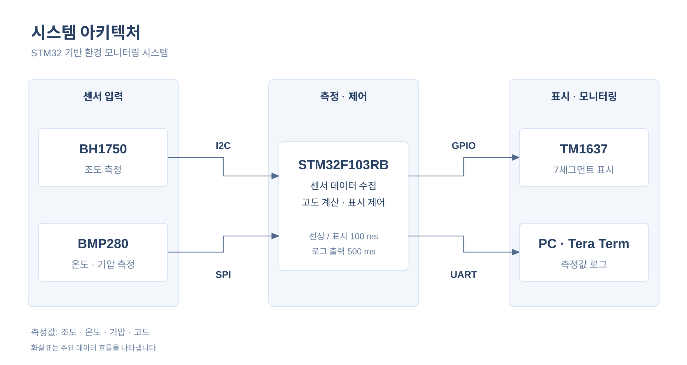

# STM32F103RB 멀티버스 환경 센서 모니터 (I2C + SPI + GPIO Bit-bang + UART)

> **한 줄 소개** — STM32F103RB에서 **I2C1(BH1750 조도)**, **SPI1(BMP280 기압·온도)** 를 읽고, **GPIO 비트뱅잉으로 구현한 TM1637 7-Segment 드라이버**에 기압을 표시하며, **USART2(115200bps)** 로 PC에 전체 측정값을 출력하는 펌웨어입니다.
-------

## 1. 개발 목적 및 해결하려는 문제

| 목적 | 구현 방식 |
|---|---|
| 서로 다른 3종 인터페이스(I2C / SPI / 단선형 2-wire 프로토콜)를 한 MCU에서 통합 | 센서별 드라이버 분리 (`bh1750.c`, `bmp280.c`, `tm1637.c`) |
| 데이터시트 기반 센서 구동 (레지스터 맵, 보정식) | BMP280 NVM 보정계수(24B) 읽기 + 데이터시트 8.1 보정식(double) 구현 |
| 전용 HW 주변장치가 없는 장치(TM1637) 제어 | GPIO + 소프트웨어 지연으로 Start/Stop/Write/ACK 직접 구현 |
| 센싱·표시·로깅 주기 분리 | `HAL_GetTick()` 기반 비차단(non-blocking) 주기 스케줄링 (100 ms / 500 ms) |

## 2. 주요 구현 기능

- **BH1750 (I2C1, 0x23)**: 존재 확인 → Power On → Continuous H-Resolution 모드 → 2바이트 수신 후 `lux = raw / 1.2`
  
- **BMP280 (SPI1, Mode 3, 8 MHz)**: Chip ID(0x58) 검증 → Soft reset → 보정계수 로드 → 오버샘플링/IIR/Normal 모드 설정 → 6바이트 버스트 리드 → 온도·기압·고도 계산
  
- **TM1637 (PB8/PB9 비트뱅잉)**: 4-digit 표시, 폰트 테이블, 문자열("TEST"/"GOOD"/"ERR "), 기압 정수값 변경 시에만 갱신
  
- **UART printf 리다이렉션**: `__io_putchar()` → `HAL_UART_Transmit()` (USART2)
  
- **부팅 시 자가 진단 표시**: 두 센서 초기화 성공 시 `GOOD`, 실패 시 `ERR ` 표시

## 3. 시스템 아키텍처

> 화살표는 주요 데이터 흐름을 나타냅니다. 측정값은 STM32F103RB에서 수집·계산되어 TM1637 7세그먼트와 PC 시리얼 로그로 전달됩니다.

## 4. 개발 환경 및 사용 기술

| 항목 | 내용 |
|---|---|
| MCU | STM32F103RBT6 (Cortex-M3, Flash 128 KB, RAM 20 KB) |
| 클럭 | HSI/2 × PLL16 = **64 MHz**|
| IDE | STM32CubeIDE|
| 펌웨어 패키지 | STM32Cube FW_F1 V1.8.7 (HAL) |
| 방식 | 베어메탈, 폴링(blocking HAL) |

## 5. 하드웨어 구성 요약

| 신호 | MCU 핀 | 연결 대상 |
|---|---|---|
| I2C1_SCL / SDA | PB6 / PB7 (Open-Drain) | BH1750 (7-bit 주소 0x23) |
| SPI1_SCK / MISO / MOSI | PA5 / PA6 / PA7 | BMP280 |
| BMP280_CS | PA4 (GPIO Output, 초기 High) | BMP280 CSB |
| TM1637_CLK / DIO | PB8 (Push-Pull) / PB9 (Open-Drain + Pull-up) | TM1637 |
| USART2_TX / RX | PA2 / PA3 | PC (115200, 8N1) |
| SWDIO / SWCLK | PA13 / PA14 | 디버거 |

회로도는 프로젝트에 없으므로 외부 부품(풀업 저항, 전원 레벨 등)은 [02_hardware.md](docs/02_hardware.md)에서 "확인 불가"로 구분했습니다.

## 6. 핵심 펌웨어 구현 내용

1. **주기 분리 Super-loop** — `HAL_GetTick()` 차분으로 100 ms 센싱 / 500 ms UART 출력. `HAL_Delay()`는 부팅 시에만 사용 (`main.c`)

2.**BMP280 보정 파이프라인** — 온도 계산으로 `t_fine`을 먼저 산출해야 기압 보정이 가능한 의존성을 코드 순서로 반영 (`bmp280.c: BMP280_ReadData`)

3. **SPI 레지스터 접근 규약** — Read는 주소 bit7=1, Write는 bit7=0, CS를 소프트웨어(GPIO)로 제어 (`BMP280_SPI_ReadRegs/WriteReg`)

4. **TM1637 비트뱅잉** — LSB-first 8bit 전송 + 9번째 클럭 ACK 샘플링. DIO를 Open-Drain+Pull-up으로 두어 ACK 입력 시 핀 충돌 방지 (`tm1637.c`)

5. **불필요한 버스 트랜잭션 제거** — 기압 정수값이 바뀔 때만 TM1637 갱신, UART는 캐시된 값 출력

자세한 내용: [04_firmware_implementation.md](docs/04_firmware_implementation.md)

## 7. 트러블슈팅 요약

Git 이력·디버깅 로그가 프로젝트에 없어, **실제 장애 이력은 만들어내지 않았습니다.** 대신 `05_troubleshooting.md`에는

- 코드 주석/구조에서 근거가 확인되는 **설계상 문제 대응 4건**
- 소스 리뷰에서 발견한 **미해결 이슈 5건** (예: `LOCAL_SEA_LEVEL_HPA` 정의만 있고 미사용 → 고도 기준값이 1013.25 hPa로 유지)
- 개발자가 직접 채워야 할 **"추가 작성이 필요한 사례"** 템플릿

을 구분하여 수록했습니다. → [05_troubleshooting.md](docs/05_troubleshooting.md)

## 8. 테스트 및 결과

- 빌드 산출물(`Debug/*.elf`, `*.map`)에서 확인된 메모리 사용량: **Flash ≈ 37.7 KiB / 128 KiB, 정적 RAM(.data+.bss) ≈ 1.1 KiB / 20 KiB**
  - ⚠ 해당 ELF 생성일(2026-09-18)이 `main.c`/`bmp280.c` 최종 수정일(2026-10-13)보다 앞서므로, **최신 소스 기준 수치가 아닐 수 있습니다.** 재빌드 후 갱신 필요.
- 실기 동작 로그, 정확도 비교, 타이밍 실측 자료는 **프로젝트에 없어 성공을 주장하지 않았습니다.** → [06_testing_and_results.md](docs/06_testing_and_results.md)

## 9. 상세 문서

| 문서 | 내용 |
|---|---|
| [01_system_architecture.md](docs/01_system_architecture.md) | 시스템 구성, 데이터 흐름, 모듈 역할 |
| [02_hardware.md](docs/02_hardware.md) | 핀 할당, 인터페이스, 외부 검증 항목 |
| [03_cubemx_configuration.md](docs/03_cubemx_configuration.md) | RCC/GPIO/I2C/SPI/UART/SysTick 설정과 계산 |
| [04_firmware_implementation.md](docs/04_firmware_implementation.md) | 핵심 코드, HAL → 레지스터 추적 |
| [05_troubleshooting.md](docs/05_troubleshooting.md) | 설계 대응, 발견 이슈, 추가 작성 필요 사례 |
| [06_testing_and_results.md](docs/06_testing_and_results.md) | 검증 현황, 한계, 개선 사항 |

## 10. 소스 구성

| 구분 | 파일 | 작성 주체 |
|---|---|---|
| 사용자 작성 | [bh1750.c](Core/Src/bh1750.c), [bmp280.c](Core/Src/bmp280.c), [tm1637.c](Core/Src/tm1637.c) 및 헤더, `main.c`의 `USER CODE` 영역 | 개발자 |
| CubeMX 생성 | `main.c` 나머지(`MX_*_Init`, `SystemClock_Config`), [stm32f1xx_hal_msp.c](Core/Src/stm32f1xx_hal_msp.c), [stm32f1xx_it.c](Core/Src/stm32f1xx_it.c) | ST 도구 |
| ST 제공 라이브러리 | `Drivers/STM32F1xx_HAL_Driver`, `Drivers/CMSIS` | ST |

> 배선 사진, 터미널 캡처, 로직 분석기 파형 등 보조 이미지는 아직 없습니다.
