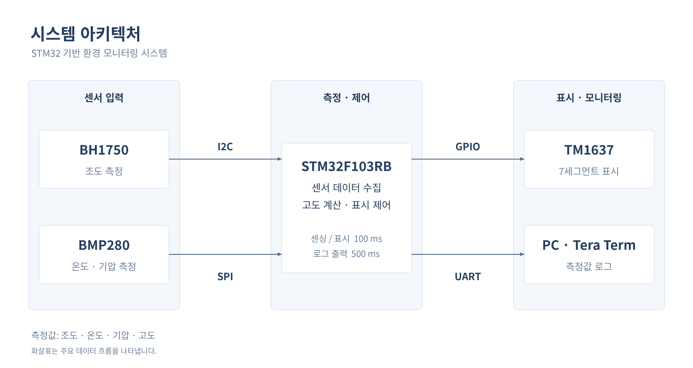
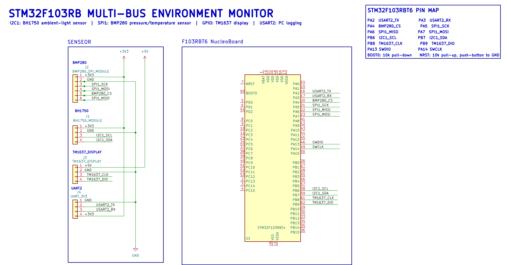

# STM32F103RB 멀티버스 환경 센서 모니터 (I2C + SPI + GPIO Bit-bang + UART)

> **한 줄 소개** — STM32F103RB에서 **I2C1(BH1750 조도)**, **SPI1(BMP280 기압·온도)** 를 읽고, **GPIO 비트뱅잉으로 구현한 TM1637 7-Segment 드라이버**에 기압을 표시하며, **USART2(115200bps)** 로 PC에 전체 측정값을 출력하는 펌웨어입니다.
-------

## 1. 개발 목적 및 해결하려는 문제

| 목적 | 구현 방식 |
|---|---|
| 서로 다른 3종 인터페이스(I2C / SPI / 단선형 2-wire 프로토콜)를 한 MCU에서 통합 | 센서별 드라이버 분리 (`bh1750.c`, `bmp280.c`, `tm1637.c`) |
| 데이터시트 기반 센서 구동 (레지스터 맵, 보정식) | BMP280 NVM 보정계수(24B) 읽기 + 데이터시트 8.1 보정식(double) 구현 |
| 전용 HW 주변장치가 없는 장치(TM1637) 제어 | GPIO + 소프트웨어 지연으로 Start/Stop/Write/ACK 직접 구현 |
| 센싱·표시·로깅 주기 분리 | `HAL_GetTick()` 기반 비차단(non-blocking) 주기 스케줄링 (BMP280 100 ms / BH1750 200 ms / UART 500 ms) |

## 2. 주요 구현 기능

- **BH1750 (I2C1, 0x23)**: 존재 확인 → Power On → Continuous H-Resolution 모드 → 2바이트 수신 후 `lux = raw / 1.2`
  
- **BMP280 (SPI1, Mode 3, 8 MHz)**: Chip ID(0x58) 검증 → Soft reset → 보정계수 로드 → 오버샘플링/IIR/Normal 모드 설정 → 온도·기압·고도 계산
  
- **TM1637 (PB8/PB9 비트뱅잉)**: 4-digit 표시, 폰트 테이블, 문자열("TEST"/"GOOD"/"ERR "), 기압 정수값 변경 시에만 갱신
  
- **UART printf 리다이렉션**: `__io_putchar()` → `HAL_UART_Transmit()` (USART2)
  
- **부팅 시 자가 진단 표시**: 두 센서 초기화 성공 시 `GOOD`, 실패 시 `ERR ` 표시

## 3. 시스템 아키텍처

> 자세한 내용은 [01_system_architecture.md](docs/01_system_architecture.md)에서 확인할 수 있습니다.

> 화살표는 주요 데이터 흐름을 나타냅니다. 측정값은 STM32F103RB에서 수집·계산되어 TM1637 7세그먼트와 PC 시리얼 로그로 전달됩니다.

## 4. 개발 환경 및 사용 기술

| 항목 | 내용 |
|---|---|
| MCU | STM32F103RBT6 (Cortex-M3, Flash 128 KB, RAM 20 KB) |
| 클럭 | HSI/2 × PLL16 = **64 MHz**|
| IDE | STM32CubeIDE|
| 펌웨어 패키지 | STM32Cube FW_F1 V1.8.7 (HAL) |
| 방식 | 베어메탈, 폴링(blocking HAL) |

## 5. 하드웨어 구성 요약

| 신호 | MCU 핀 | 연결 대상 |
|---|---|---|
| I2C1_SCL / SDA | PB6 / PB7 (Open-Drain) | BH1750 (7-bit 주소 0x23) |
| SPI1_SCK / MISO / MOSI | PA5 / PA6 / PA7 | BMP280 |
| BMP280_CS | PA4 (GPIO Output, 초기 High) | BMP280 CSB |
| TM1637_CLK / DIO | PB8 / PB9 (둘 다 Open-Drain, 모듈 10 kΩ 풀업이 5 V High 생성) | TM1637 |
| USART2_TX / RX | PA2 / PA3 | PC (115200, 8N1) |
| SWDIO / SWCLK | PA13 / PA14 | 디버거 |

자세한 내용: [02_hardware.md](docs/02_hardware.md)

## 6. 핵심 펌웨어 구현 내용

1. **주기 분리 Super-loop** — `HAL_GetTick()` 차분으로 100 ms BMP280 센싱 / 200 ms BH1750 조도(측정 시간 max 180 ms 반영) / 500 ms UART 출력. `HAL_Delay()`는 부팅 시에만 사용 (`main.c`)

2.**BMP280 보정 파이프라인** — 온도 계산으로 `t_fine`을 먼저 산출해야 기압 보정이 가능한 의존성을 코드 순서로 반영 (`bmp280.c: BMP280_ReadData`)

3. **SPI 레지스터 접근 규약** — Read는 주소 bit7=1, Write는 bit7=0, CS를 소프트웨어(GPIO)로 제어 (`BMP280_SPI_ReadRegs/WriteReg`)

4. **TM1637 비트뱅잉** — LSB-first 8bit 전송 + 9번째 클럭 ACK 샘플링. CLK·DIO를 모두 Open-Drain으로 두고 High는 모듈의 5 V 풀업이 만들게 하여, ACK 입력 시 핀 충돌을 막고 TM1637 VIH(3.5 V)를 만족 (`tm1637.c`, [02_hardware.md](docs/02_hardware.md) 4-1절)

5. **불필요한 버스 트랜잭션 제거** — 기압 정수값이 바뀔 때만 TM1637 갱신, UART는 캐시된 값 출력

자세한 내용: [04_firmware_implementation.md](docs/04_firmware_implementation.md)

## 7. 트러블슈팅 요약

### [실제 사례 1] BMP280 SPI 통신 실패 — NUCLEO 모르포 핀 오배선

| 단계 | 내용 |
|---|---|
| **증상** | 부팅 시 TM1637에 `ERR `, UART에 `BMP280 Sensor Initialization FAILED!` (Chip ID ≠ 0x58) |
| **측정** | 멀티미터로 전원·납땜 정상 확인 → 오실로스코프 2채널로 BMP280의 SCK(CH1)·CSB(CH2) 측정 |
| **단서** | **CSB는 High → Low → High로 정상인데 SCK에는 클럭이 없음** → 펌웨어가 아니라 신호 경로 문제 |
| **원인** | NUCLEO 보드 회로도(MB1136) 추적: CN10-26/28/30은 F103RB에서 솔더 브리지 설정상 **PB15/PB14/PB13**에 연결 (PA7/PA6/PA5 연결은 F302R8 전용, SB39 OPEN을 보드에서 육안 확인) |
| **해결** | SPI 3선을 PA5/PA6/PA7이 실제로 연결된 **CN10-11/13/15**(D13/D12/D11)로 이동 → 정상 동작. 디버깅 중 낮췄던 SPI 설정(Mode 0, 1 MHz)과 최종 설정(Mode 3, 8 MHz) **모두 동작 확인** |
| **교훈** | 개발 보드 핀은 MCU 핀 이름이 아니라 **보드 회로도 + 솔더 브리지 상태**로 확인 |

| 수정 전: CSB(초록)는 토글하지만 SCK(노랑)는 변화 없음 | 원인: CN10 핀의 솔더 브리지 구성 |
|---|---|
|  |  |

### [실제 사례 2] 고도가 음수로 출력 — 기준 기압 미설정

| 단계 | 내용 |
|---|---|
| **증상** | 책상 위에서 고도 **−42.7 m** 출력 (기압 1018.4 hPa) |
| **단서** | 로그의 기압을 고도 공식에 직접 넣으니 로그와 같은 −42.76 m → **계산 코드는 정상, 입력값 문제** |
| **원인** | 기준 기압이 기본값 1013.25 hPa로 남아 있음 (측정 기압이 더 높아 음수). 현지 기준값 상수는 정의만 되고 호출되지 않음 |
| **해결** | 부팅 직후 첫 측정 완료(데이터시트 max 43.2 ms → 50 ms 대기)를 기다려 그 기압을 기준으로 설정 → **부팅 위치 = 0 m 상대 고도** |

이 밖에 설계 단계에서 대응한 문제 4건과, 소스·데이터시트 리뷰와 보드 테스트로 찾은 이슈 5건을 정리했습니다. 이 중 4건을 코드로 수정했습니다.
- 데이터시트 근거: BH1750 읽기 주기 200 ms, TM1637 CLK 3.3 V 구동이 VIH 3.5 V에 못 미쳐 Open-Drain으로 변경
- 코드 리뷰: BH1750 읽기 실패 감지(연속 실패 카운터), `printf` 줄바꿈 `\r` 중복 제거

→ 전체 디버깅 과정과 측정 사진: [05_troubleshooting.md](docs/05_troubleshooting.md)

## 8. 테스트 및 결과

요구사항마다 합격 기준을 정하고 보드에서 검증했습니다. 모든 결과에 로그·사진·레지스터 캡처 증거를 붙였습니다.

| 구분 | 결과 | 근거 |
|---|---|---|
| 센서 통신 | BMP280 Chip ID `0x58`, 고도 들어 올림 **+1.176 m** / 내림 **−0.629 m**, 조도 0.0 ~ 140.8 lx | Tera Term 로그 |
| 자가진단 | 정상 부팅 `TEST` → `GOOD` → 기압, BMP280 전원 분리 시 `TEST` → `ERR ` | 영상 캡처 |
| 주기 스케줄링 | UART 출력 간격 평균 **500.42 ms** (316개 간격, 표준편차 2.1 ms) | 타임스탬프 로그 원본 |
| 레벨 호환 | 5V 핀 4.886 V → VIH 3.42 V, Open-Drain CLK High **4.909 V** (Push-Pull 3.3 V는 부족) | 멀티미터 |
| 주변장치 설정 | `SPI1->CR1` 0x357, `I2C1->CCR` 0xA0, `TRISE` 0x21, `USART2->BRR` 0x116 → 계산값과 모두 일치 | 디버거 SFR |
| 고장 주입 | SPI 오배선 → `ERR `, BMP280 전원 분리 → `ERR `, 동작 중 I2C 선 분리 → `FAILED` 로그 1회 | 로그·사진 |
| 리소스 | Flash **38.5 KiB / 128 KiB (30.1 %)**, RAM **2.6 KiB / 20 KiB (13.0 %, Heap·Stack 포함)** | 최신 빌드 ELF |

→ 검증 매트릭스와 전체 증거: [06_testing_and_results.md](docs/06_testing_and_results.md)

## 9. 상세 문서

| 문서 | 내용 |
|---|---|
| [01_system_architecture.md](docs/01_system_architecture.md) | 시스템 구성, 데이터 흐름, 모듈 역할 |
| [02_hardware.md](docs/02_hardware.md) | 핀 할당, 인터페이스, 외부 검증 항목 |
| [03_cubemx_configuration.md](docs/03_cubemx_configuration.md) | RCC/GPIO/I2C/SPI/UART/SysTick 설정과 계산 |
| [04_firmware_implementation.md](docs/04_firmware_implementation.md) | 핵심 코드, HAL → 레지스터 추적 |
| [05_troubleshooting.md](docs/05_troubleshooting.md) | 실제 디버깅 사례 2건(SPI 오배선, 고도 기준값), 설계 대응, 발견 이슈 |
| [06_testing_and_results.md](docs/06_testing_and_results.md) | 검증 매트릭스(R1~R9), 고장 주입 3건, 레지스터·멀티미터 확인, 리소스, 한계 |

## 10. 소스 구성

| 구분 | 파일 | 작성 주체 |
|---|---|---|
| 사용자 작성 | [bh1750.c](Core/Src/bh1750.c), [bmp280.c](Core/Src/bmp280.c), [tm1637.c](Core/Src/tm1637.c) 및 헤더, `main.c`의 `USER CODE` 영역 | 개발자 |
| CubeMX 생성 | `main.c` 나머지(`MX_*_Init`, `SystemClock_Config`), [stm32f1xx_hal_msp.c](Core/Src/stm32f1xx_hal_msp.c), [stm32f1xx_it.c](Core/Src/stm32f1xx_it.c) | ST 도구 |
| ST 제공 라이브러리 | `Drivers/STM32F1xx_HAL_Driver`, `Drivers/CMSIS` | ST |
