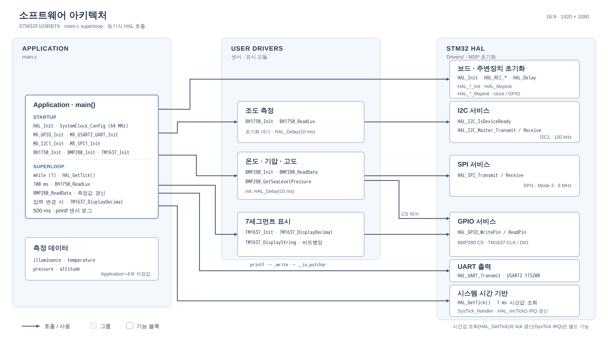
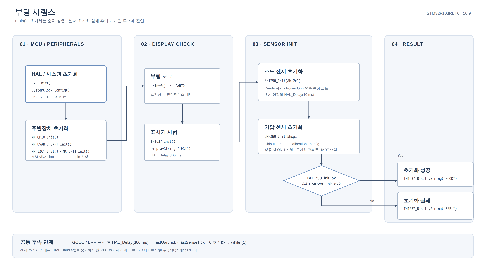
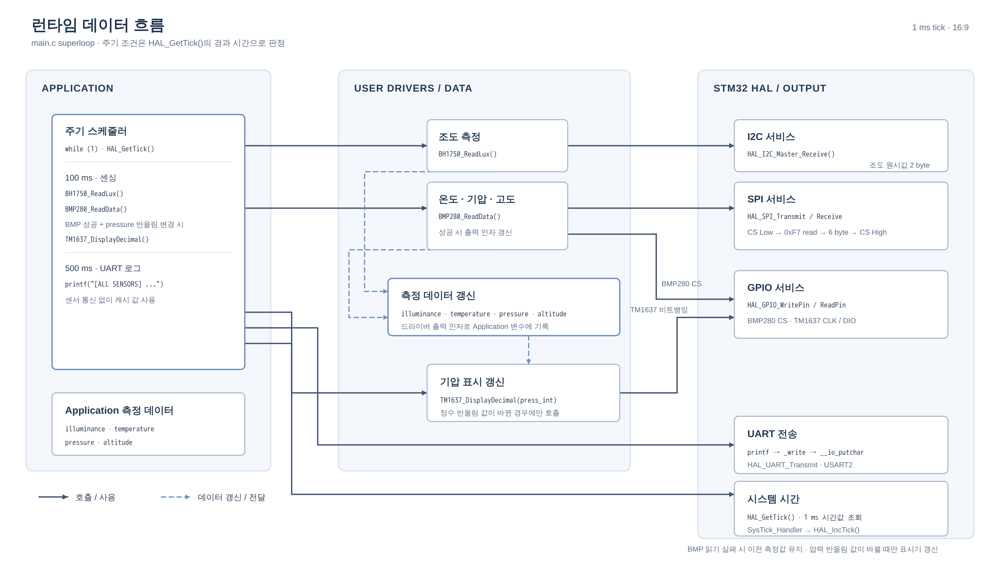

# 01. 시스템 아키텍처

> 파일: [main.c](../Core/Src/main.c), [bh1750.c](../Core/Src/bh1750.c), [bmp280.c](../Core/Src/bmp280.c), [tm1637.c](../Core/Src/tm1637.c), [stm32f1xx_hal_msp.c](../Core/Src/stm32f1xx_hal_msp.c), [stm32f1xx_it.c](../Core/Src/stm32f1xx_it.c), [syscalls.c](../Core/Src/syscalls.c), [.ioc](../p116.103RB_TM1637_BH1750_BMP280_SPI.ioc)

## 1. 시스템 구성 요소

| 구성 요소 | 역할 | 인터페이스 | 데이터 방향 |
|---|---|---|---|
| STM32F103RBT6 | 마스터 MCU, 센싱·표시·로깅 스케줄링 | — | — |
| BH1750 | 조도 센서 (16-bit raw → lx) | I2C1 (100 kHz) | 센서 → MCU (측정값), MCU → 센서 (명령) |
| BMP280 | 기압/온도 센서 | SPI1 (8 MHz, Mode 3) + GPIO CS | 양방향 (레지스터 R/W) |
| TM1637 | 4-digit 7-segment 구동 IC | GPIO 2선 (CLK/DIO) 비트뱅잉 | MCU → 표시기 (ACK는 표시기 → MCU) |
| PC 터미널 | 로그 수신 | USART2 TX (PA2) | MCU → PC |    

## 2. 전체 구조

편집 가능한 [draw.io 원본](images/system_architecture.drawio)과 [SVG](images/system_architecture.svg), [고해상도 PNG](images/system_architecture.png)를 제공합니다. 화살표는 호출·사용 관계를 나타내며, 측정 데이터는 Application 내부 저장 영역으로 구분했습니다. `HAL_GetTick()`은 1 ms 시간값을 읽고, 별도의 `SysTick_Handler`가 `HAL_IncTick()`으로 시간을 갱신합니다.

## 3. 실제 동작 순서

### 3-1. 부팅 시퀀스 (`main()`)

[편집 가능한 SVG 원본](images/boot_sequence.svg) · [고해상도 PNG](images/boot_sequence.png)

> 센서 초기화 실패 시에도 루프는 계속 진행됩니다 (`Error_Handler` 호출 없음). 실패는 UART 메시지와 `ERR ` 표시로만 알립니다.

### 3-2. 런타임 데이터 흐름

[편집 가능한 SVG 원본](images/runtime_data_flow.svg) · [고해상도 PNG](images/runtime_data_flow.png)

| 주기 / 조건 | 호출 및 처리 | 데이터 영향 |
|---|---|---|
| 100 ms | `BH1750_ReadLux(&hi2c1, &illuminance)` | I2C 수신 성공 시 조도 갱신. 반환 상태는 `main.c`에서 검사하지 않으므로 실패 시 이전 값 유지 |
| 100 ms | `BMP280_ReadData(&hspi1, &temperature, &pressure, &altitude)` 성공 시 압력 반올림값 비교 | 성공한 경우 온도·기압·고도 갱신. 반올림 압력이 `lastDisplayedPress`와 다를 때만 `TM1637_DisplayDecimal()` 호출 |
| 500 ms | `printf("[ALL SENSORS] ...")` → `_write` → `__io_putchar` → `HAL_UART_Transmit` | 센서 통신 없이 Application에 저장된 최신 측정값을 USART2로 출력 |

루프마다 `HAL_GetTick()`을 한 번 읽고, 센싱 조건을 먼저 검사한 다음 UART 출력 조건을 검사합니다. 두 조건이 같은 반복에서 모두 참이면 UART는 해당 반복에서 갱신된 값을 출력합니다. BMP280 읽기가 실패하면 출력 인자는 갱신되지 않아 이전 측정값이 유지됩니다.

## 4. 소프트웨어 모듈 역할

| 모듈 | 파일 | 공개 API | 비고 |
|---|---|---|---|
| 애플리케이션 | `main.c` (USER CODE) | — | 스케줄링, 상태 표시, `__io_putchar` |
| BH1750 드라이버 | `bh1750.c/.h` | `BH1750_Init`, `BH1750_ReadLux` | HAL I2C 위에 구현 |
| BMP280 드라이버 | `bmp280.c/.h` | `BMP280_Init`, `BMP280_ReadData`, `Set/GetSeaLevelPressure` | 보정계수를 `static`으로 보관 |
| TM1637 드라이버 | `tm1637.c/.h` | `TM1637_Init/Clear/DisplayRaw/DisplayDecimal/DisplayFloat/DisplayString/SetBrightness/DisplayOn/Off` | 비트뱅잉 |
