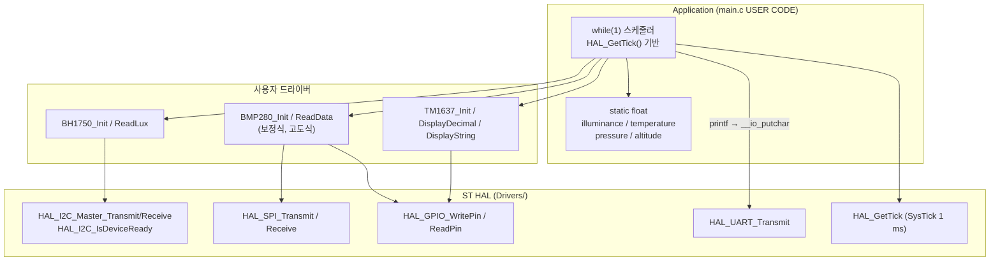
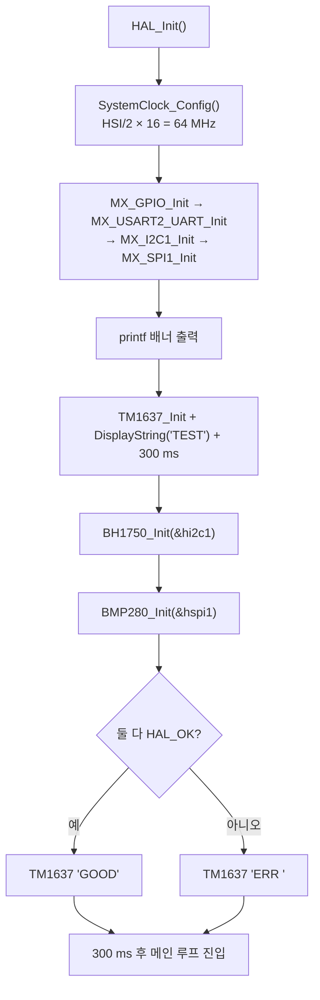
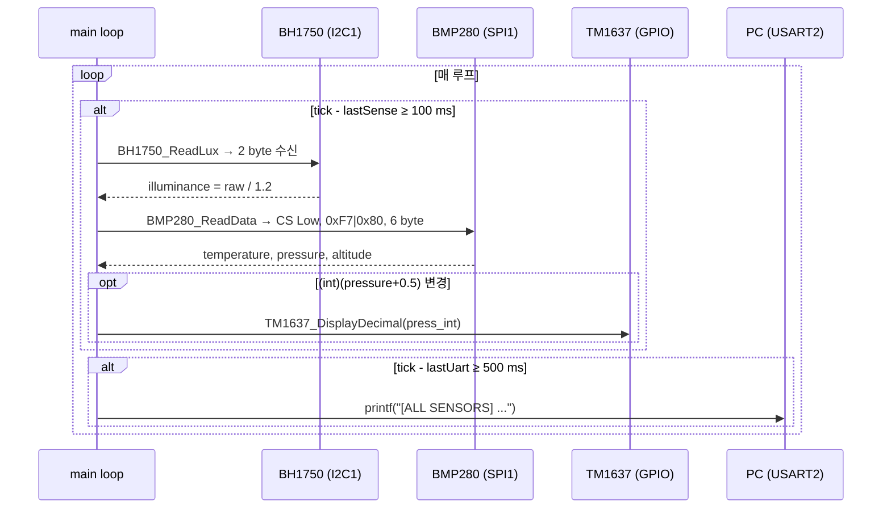

# 01. 시스템 아키텍처

> 파일: [main.c](../Core/Src/main.c), [bh1750.c](../Core/Src/bh1750.c), [bmp280.c](../Core/Src/bmp280.c), [tm1637.c](../Core/Src/tm1637.c), [.ioc](../p116.103RB_TM1637_BH1750_BMP280_SPI.ioc)

## 1. 시스템 구성 요소

| 구성 요소 | 역할 | 인터페이스 | 데이터 방향 |
|---|---|---|---|
| STM32F103RBT6 | 마스터 MCU, 센싱·표시·로깅 스케줄링 | — | — |
| BH1750 | 조도 센서 (16-bit raw → lx) | I2C1 (100 kHz) | 센서 → MCU (측정값), MCU → 센서 (명령) |
| BMP280 | 기압/온도 센서 | SPI1 (8 MHz, Mode 3) + GPIO CS | 양방향 (레지스터 R/W) |
| TM1637 | 4-digit 7-segment 구동 IC | GPIO 2선 (CLK/DIO) 비트뱅잉 | MCU → 표시기 (ACK는 표시기 → MCU) |
| PC 터미널 | 로그 수신 | USART2 TX (PA2) | MCU → PC |    

## 2. 전체 구조

## 3. 실제 동작 순서

### 3-1. 부팅 시퀀스 (`main()`)

> 센서 초기화 실패 시에도 루프는 계속 진행됩니다 (`Error_Handler` 호출 없음). 실패는 UART 메시지와 `ERR ` 표시로만 알립니다.

### 3-2. 런타임 데이터 흐름

| 단계 | 입력 | 처리 | 출력 |
|---|---|---|---|
| ① 조도 | I2C 2 byte | `((buf[0]<<8) \| buf[1]) / 1.2f` | `illuminance` [lx] |
| ② 온도/기압 | SPI 6 byte (0xF7~0xFC) | 20-bit 조합 → 온도 보정(→`t_fine`) → 기압 보정(Pa→hPa) | `temperature` [℃], `pressure` [hPa] |
| ③ 고도 | `pressure`, 기준 해면기압 | `44330·(1 − (P/P0)^0.1902949)` | `altitude` [m] |
| ④ 표시 | `pressure` | 반올림 정수 → 변경 시 TM1637 전송 | 4-digit LED |
| ⑤ 로그 | 캐시된 4개 변수 | `printf` | UART 약 90바이트 줄 |

## 4. 소프트웨어 모듈 역할

| 모듈 | 파일 | 공개 API | 비고 |
|---|---|---|---|
| 애플리케이션 | `main.c` (USER CODE) | — | 스케줄링, 상태 표시, `__io_putchar` |
| BH1750 드라이버 | `bh1750.c/.h` | `BH1750_Init`, `BH1750_ReadLux` | HAL I2C 위에 구현 |
| BMP280 드라이버 | `bmp280.c/.h` | `BMP280_Init`, `BMP280_ReadData`, `Set/GetSeaLevelPressure` | 보정계수를 `static`으로 보관 |
| TM1637 드라이버 | `tm1637.c/.h` | `TM1637_Init/Clear/DisplayRaw/DisplayDecimal/DisplayFloat/DisplayString/SetBrightness/DisplayOn/Off` | 비트뱅잉 |
