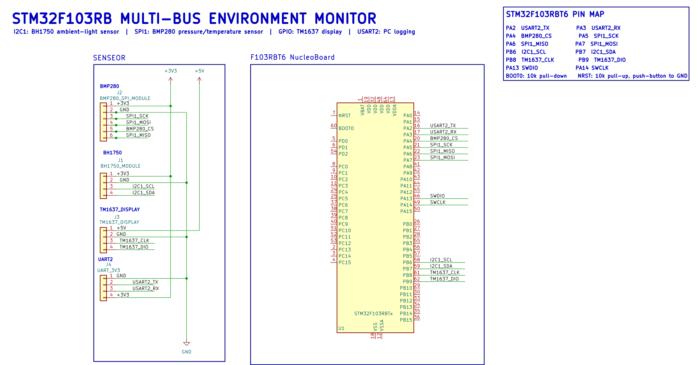
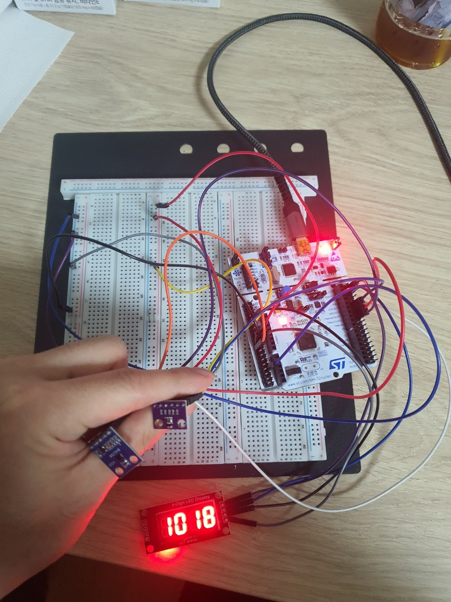
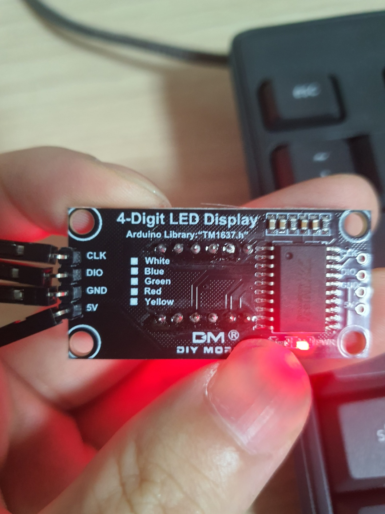
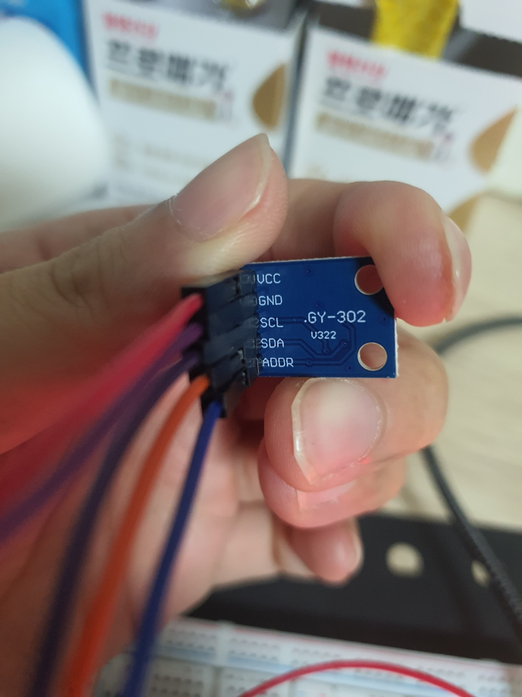
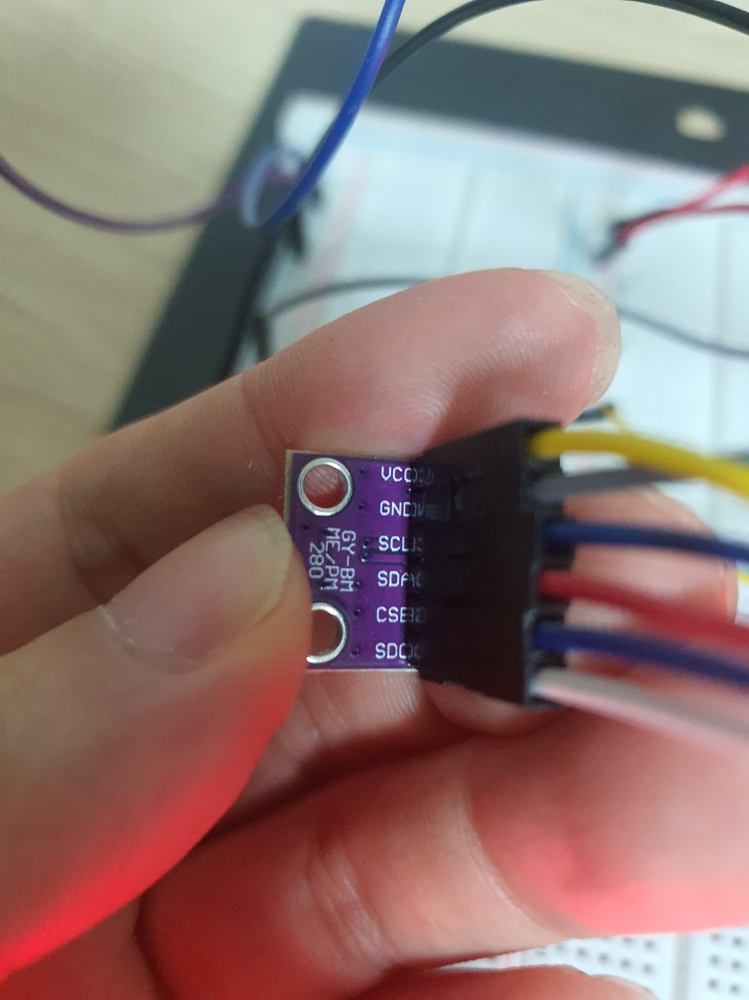
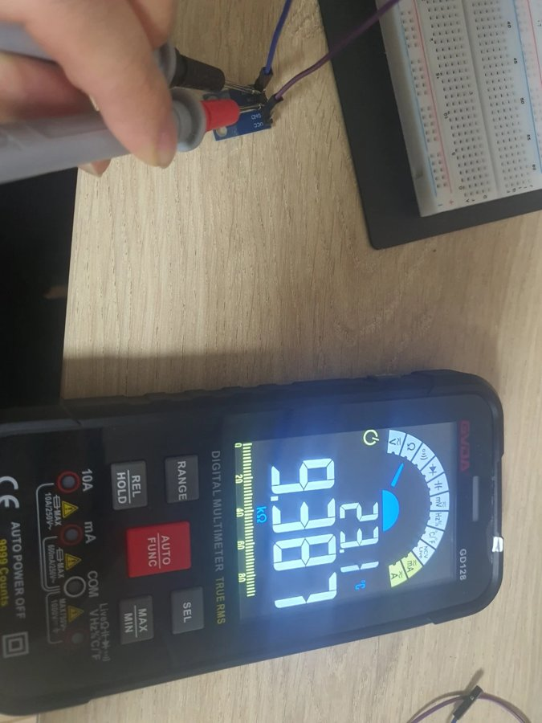
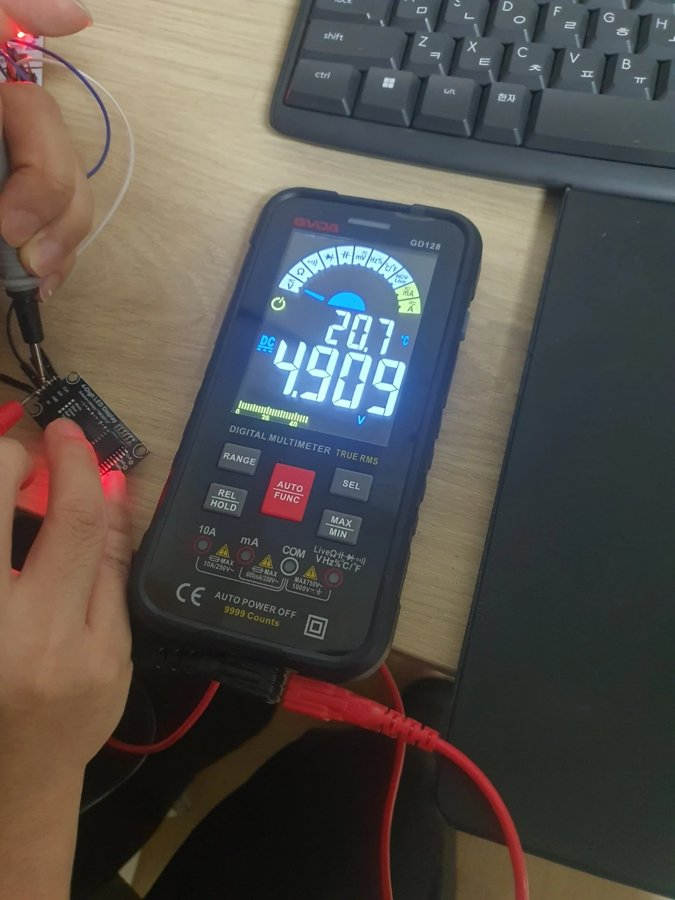
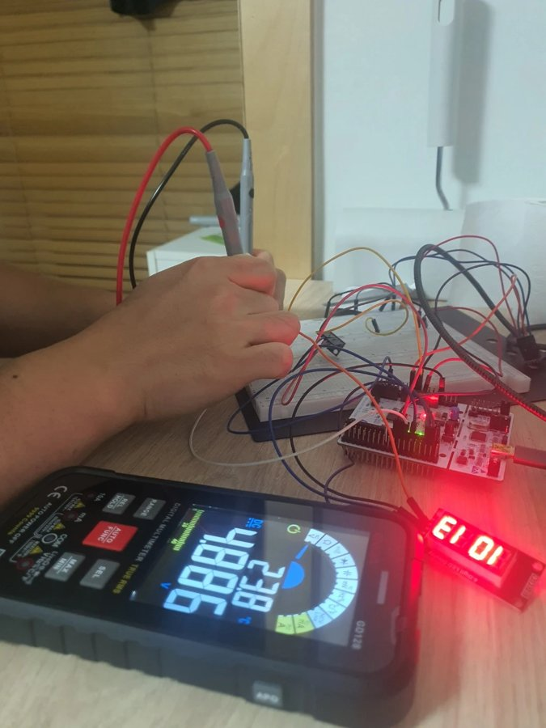

# 02. 하드웨어 회로 구성 및 인터페이스 분석

> **한 줄 요약** — NUCLEO 보드(3.3 V MCU)에 센서 2개(3.3 V)와 7-Segment 표시기(5 V)를 연결했습니다. 표시기만 전압이 달라서, **"3.3 V 칩과 5 V 칩이 서로 신호를 제대로 알아듣는가"**를 데이터시트와 멀티미터로 확인한 것이 이 문서의 핵심입니다.
>
> 근거 표기: **데이터시트**(부품 제조사 문서) · **레퍼런스 매뉴얼**(STM32 내부 동작 설명서, RM0008) · **모듈 회로도**(실제 모듈에 달린 부품) · **실측**(멀티미터로 직접 잰 값). 쪽수는 PDF 뷰어 기준입니다.
>
> 참고 문서: STM32F103x8/xB 데이터시트(DS5319), STM32F10x 레퍼런스 매뉴얼(RM0008), BMP280 데이터시트(Bosch), BH1750FVI 데이터시트(ROHM), TM1637 데이터시트 V2.1(Titan Micro), TM1637 모듈 회로도(CATALEX 4-Digit Display v0.9b)

### 실제 배선 및 모듈 사진

| TM1637 4자리 모듈 | GY-302 (BH1750) | GY-BMP280 |
|---|---|---|
|  |  |  |
| 핀: CLK / DIO / GND / 5V | 핀: VCC / GND / SCL / SDA / ADDR (5핀 모두 결선) | 핀: VCC / GND / SCL / SDA / CSB / SDO |

## 0. 먼저 알아 둘 용어

이 문서에 반복해서 나오는 말입니다. 아래 내용만 알면 나머지 표를 읽을 수 있습니다.

| 용어 | 쉽게 말하면 | 이 프로젝트에서 |
|---|---|---|
| **High / Low** | 신호선의 1과 0. High는 전원 전압 쪽, Low는 0 V(GND) | MCU의 High = 3.3 V, TM1637 쪽 High = 약 5 V |
| **풀업(pull-up) 저항** | 신호선과 전원 사이에 단 저항. 아무도 선을 Low로 당기지 않으면 선이 **저절로 High**가 되게 해 줌 | I2C 선(GY-302 모듈 안 4.7 kΩ), TM1637 선(모듈 안 10 kΩ) |
| **Push-Pull 출력** | 핀이 **직접** High(3.3 V)와 Low(0 V)를 만들어 내는 방식 | SPI 핀, BMP280 CS 핀 |
| **Open-Drain 출력** | 핀은 **"Low로 당기기"와 "손 떼기" 두 가지만** 할 수 있음. 손을 떼면 풀업 저항이 선을 High로 올림. 그래서 **High 전압 = 풀업이 연결된 전원 전압** | I2C 핀, TM1637 CLK·DIO 핀 |
| **VIH** | 받는 칩이 "이건 High다"라고 **인정해 주는 최소 전압**. 이보다 낮으면 High로 못 알아들을 수 있음 | TM1637은 5 V 전원에서 약 3.5 V 이상이어야 High |
| **5 V tolerant (FT) 핀** | 3.3 V 칩이지만 그 핀에 **5 V가 들어와도 망가지지 않는** 핀 | PB8, PB9 (TM1637 연결 핀) |
| **ACK** | 받는 쪽이 "잘 받았다"고 대답하는 신호. 보통 받는 칩이 선을 Low로 당김 | TM1637이 바이트마다 DIO를 Low로 당김 |
| **레귤레이터(LDO)** | 들어온 전압을 3.3 V 등으로 낮춰 일정하게 만들어 주는 부품 | GY-302 모듈 안에 있음 |

## 1. 구성 요소와 역할

| 장치 | 사용 제품 | 전원 | 하는 일 |
|---|---|---|---|
| STM32F103RBT6 | NUCLEO-F103RB 보드 | USB (ST-LINK) | 두뇌 역할. 센서를 읽고 표시기와 PC로 보냄 |
| BH1750 | GY-302 모듈 | 3.3 V | 밝기(조도, lux) 측정. **I2C**로 연결, 주소 0x23 |
| BMP280 | GY-BMP280 6핀 모듈 | 3.3 V | 기압·온도 측정. **SPI**로 연결 |
| TM1637 | 4자리 7-Segment 모듈 | **5 V** (NUCLEO 5V 핀) | 숫자 4자리 표시. **GPIO 2개**로 직접 신호를 만들어 연결 |
| PC 로그 | NUCLEO 보드의 ST-LINK | — | **UART**로 PC(Tera Term)에 값 출력 |

**왜 TM1637만 5 V인가?** TM1637 데이터시트의 동작 전압이 5 V ± 10 % (4.5~5.5 V)라서 3.3 V로는 사양 밖입니다 (TM1637 데이터시트 p.2). 그래서 이 한 부분만 전압이 다르고, 4-1절에서 이 차이를 따로 확인했습니다.

## 2. MCU 핀 할당표

어느 MCU 핀이 어느 모듈 핀에 연결되는지 정리한 표입니다 (근거: `.ioc`, `main.h`, `stm32f1xx_hal_msp.c`, 회로도).

| 핀 | 기능 | 출력 방식 | 시작 상태 | 연결 대상 |
|---|---|---|---|---|
| PA2 | USART2_TX (PC로 보내기) | Push-Pull | — | ST-LINK → PC |
| PA3 | USART2_RX (PC에서 받기) | 입력 | — | ST-LINK (코드에서 수신은 안 씀) |
| PA4 | BMP280 CS (칩 선택) | Push-Pull | High | BMP280 CSB |
| PA5 | SPI1 SCK (클럭) | Push-Pull | — | BMP280 SCL 핀 |
| PA6 | SPI1 MISO (센서 → MCU) | 입력 | — | BMP280 SDO 핀 |
| PA7 | SPI1 MOSI (MCU → 센서) | Push-Pull | — | BMP280 SDA 핀 |
| PB6 | I2C1 SCL (클럭) | Open-Drain | — | BH1750 SCL |
| PB7 | I2C1 SDA (데이터) | Open-Drain | — | BH1750 SDA |
| PB8 | TM1637 CLK (클럭) | Open-Drain | High | TM1637 CLK |
| PB9 | TM1637 DIO (데이터) | Open-Drain | High | TM1637 DIO |
| PA13 / PA14 | SWD 디버깅 | — | — | 보드 내장 ST-LINK |

> **BMP280 핀 이름 주의:** 모듈에는 I2C 기준 이름(SCL/SDA)이 인쇄되어 있지만, SPI로 쓸 때는 **SCL = 클럭(SCK), SDA = MCU → 센서 데이터(MOSI), SDO = 센서 → MCU 데이터(MISO), CSB = 칩 선택(CS)**입니다.

## 3. 인터페이스별 신호선

### 3-1. I2C1 — BH1750 (조도 센서)

**쉽게 말하면:** 선 2개(SCL 클럭, SDA 데이터)를 여러 장치가 같이 쓰는 방식입니다. 그래서 각 장치에 **주소**가 있고, 핀은 Open-Drain + 풀업 저항으로 구성합니다 (누가 Low로 당겨도 서로 부딪히지 않게 하려는 것).

| 신호 | 방향 | 내용 |
|---|---|---|
| SCL (PB6) | MCU → 센서 | 클럭. 100 kHz |
| SDA (PB7) | 양쪽 | 데이터. MCU가 보낼 때도, 센서가 대답할 때도 이 선 하나를 씀 |
| ADDR | — | GND에 연결 → 주소 **0x23** |

- **주소:** ADDR 핀을 GND에 연결하면 주소가 `0x23`입니다 (BH1750FVI 데이터시트 p.7). HAL 함수에는 `0x23 << 1 = 0x46`을 넘깁니다. I2C는 7비트 주소 뒤에 "읽기/쓰기" 1비트를 붙여 8비트로 보내기 때문에, 주소를 한 칸 왼쪽으로 밀어서 넘기는 것이 HAL 규칙입니다.
- **속도:** 센서는 최대 400 kHz까지 되므로 100 kHz는 여유 있게 안쪽입니다 (데이터시트 p.2).
- **읽는 주기:** 센서가 한 번 재는 데 최대 180 ms가 걸립니다 (데이터시트 p.2). 그래서 그보다 긴 **200 ms마다** 읽습니다 ([05_troubleshooting.md](05_troubleshooting.md) 4장 4번).
- 회로도의 J1(4핀)에는 ADDR 연결이 그려져 있지 않습니다. 실제로는 GND에 연결되어 있습니다.

### 3-2. SPI1 — BMP280 (기압·온도 센서)

**쉽게 말하면:** I2C보다 선이 많지만(4개) 빠른 방식입니다. 주소 대신 **CS 선**으로 "지금 너랑 통신한다"고 골라 줍니다 (CS를 Low로 내리면 선택).

| 신호 | 방향 | 내용 |
|---|---|---|
| SCK (PA5) | MCU → 센서 | 클럭. 8 MHz |
| MOSI (PA7) | MCU → 센서 | MCU가 보내는 데이터 |
| MISO (PA6) | 센서 → MCU | 센서가 보내는 데이터 |
| CS (PA4) | MCU → 센서 | Low일 때 센서 선택. 코드에서 직접 High/Low 제어 |

- **속도:** BMP280은 최대 10 MHz까지 되므로 8 MHz는 안쪽입니다 (BMP280 데이터시트 p.2, 5.3절 p.30).
- **SPI Mode 3:** "클럭이 쉬고 있을 때 High이고, 클럭이 올라가는 순간에 데이터를 읽는다"는 약속입니다. BMP280은 Mode 0과 Mode 3을 지원하므로 맞습니다 (데이터시트 p.30~31).
- **I2C가 아니라 SPI로 동작하는 이유:** 이 모듈은 I2C와 SPI 둘 다 됩니다. CS를 한 번이라도 Low로 내리면 센서가 "SPI 모드"로 고정되고, 전원을 다시 켤 때까지 유지됩니다 (데이터시트 5.1절 p.28). 그래서 부팅 때 CS를 High로 두었다가 첫 통신에서 Low로 내립니다.

### 3-3. TM1637 — GPIO 2선 (7-Segment 표시기)

**쉽게 말하면:** I2C와 비슷하게 선 2개(CLK, DIO)를 쓰지만 주소가 없고 비트 순서도 반대라서, STM32의 I2C 기능을 못 씁니다. 그래서 **GPIO 핀을 코드로 직접 High/Low 하면서 신호를 만들었습니다** (비트뱅잉, `tm1637.c`).

| 신호 | 방향 | 내용 |
|---|---|---|
| CLK (PB8) | MCU → TM1637 | 클럭. Open-Drain, High는 모듈 풀업이 만듦 |
| DIO (PB9) | 양쪽 | 데이터. MCU가 보내고, TM1637이 ACK로 대답 |

- **비트 순서:** 낮은 비트부터 보냅니다(LSB-first) (TM1637 데이터시트 p.3, p.10 예제 코드).
- **ACK:** 8비트를 다 보내면 TM1637이 DIO를 Low로 당겨 "받았다"고 대답합니다 (데이터시트 p.2). 이때 MCU는 DIO에서 손을 떼고(High-Z) 선 상태를 읽습니다.
- **모듈에 달린 부품:** 모듈 회로도를 보면 CLK·DIO 선마다 **10 kΩ 풀업(5 V 쪽)**과 **100 pF 커패시터(GND 쪽)**가 달려 있습니다. 칩 데이터시트의 권장 회로(p.13)와 같은 값입니다.

### 3-4. USART2 — PC 로그

| 항목 | 내용 |
|---|---|
| 설정 | 115200 bps, 8N1 |
| 경로 | PA2 → NUCLEO 보드의 ST-LINK → USB → PC (Tera Term) |
| 방향 | MCU → PC 출력만 사용 (`printf`) |

**쉽게 말하면:** 디버깅용 USB 케이블 하나로 프로그램 다운로드, 전원, 로그 출력을 모두 합니다. 별도 USB-UART 모듈이 필요 없습니다. NUCLEO-64 보드는 기본 설정에서 PA2/PA3가 ST-LINK에 연결되어 있습니다 (NUCLEO-64 일반 구성: 솔더 브리지 SB13/SB14 ON).

## 4. 전기적 특성

| 항목 | 값 | 근거 |
|---|---|---|
| MCU 클럭 | 64 MHz | `.ioc` |
| I2C 속도 | 100 kHz | `hi2c1.Init.ClockSpeed` |
| SPI 속도 | 8 MHz | `.ioc` |
| 센서 전원 | 3.3 V | 회로도 J1-1, J2-1 |
| TM1637 전원 | 5 V (NUCLEO 5V 핀) | 회로도 J3-1, 실측 4.886 V |
| MCU ↔ 센서 전압 | 3.3 V ↔ 3.3 V | 같은 전원이라 그대로 연결 가능 |
| I2C 풀업 저항 | 약 4.7 kΩ (GY-302 모듈 안에 있음) | **실측** (아래 표) |
| TM1637 풀업 · 커패시터 | 10 kΩ · 100 pF | **모듈 회로도** (`datasheet/SZH-LD5112/4-Digit Display v0.9b schematic.pdf`) |

### GY-302 I2C 풀업 저항 측정

I2C는 풀업 저항이 꼭 있어야 동작합니다. MCU 내부 풀업은 켜지 않았으므로, 모듈 안에 저항이 있는지 멀티미터로 확인했습니다. GY-302 모듈 회로도는 자료 폴더에 없어서 실측으로 판단했습니다.

| 측정 (전원 끄고 모듈만 분리) | 결과 | 쉽게 풀면 |
|---|---|---|
| VCC 핀 ↔ SCL 핀 | 15.97 MΩ (사실상 끊김) | 풀업이 VCC 핀에 바로 붙어 있지 않다는 뜻. 모듈 안 **레귤레이터의 3.3 V 출력**에 붙어 있는 구조로 판단. 전원이 꺼진 레귤레이터를 거꾸로 지나가야 해서 저항이 거의 무한대로 나옴 |
| SCL 핀 ↔ SDA 핀 | **9.387 kΩ** | SCL 풀업과 SDA 풀업이 같은 3.3 V 점에 붙어 있으므로, 멀티미터는 **SCL → 저항 → 3.3 V 점 → 저항 → SDA**로 저항 2개를 이어서 잼. 9.387 ÷ 2 ≈ **4.7 kΩ** (흔히 쓰는 표준값) |

### 4-1. TM1637 5 V 구동과 3.3 V MCU의 레벨 차이

이 프로젝트에서 하드웨어적으로 가장 신경 쓴 부분입니다. MCU는 3.3 V, TM1637은 5 V라서 두 가지를 확인해야 합니다.

1. **MCU가 안 망가지는가?** — TM1637 쪽 5 V가 MCU 핀으로 들어와도 괜찮은가
2. **TM1637이 알아듣는가?** — MCU가 내보내는 High를 TM1637이 High로 인정하는가

#### ① MCU가 안 망가지는가 → 괜찮음

| 확인 | 내용 | 근거 |
|---|---|---|
| PB8/PB9는 5 V를 견디는 핀인가 | 네. 두 핀 모두 **FT(5 V tolerant)** 핀 | STM32F103 데이터시트 핀 정의 표, PDF 33쪽 |
| FT 핀의 조건 | 5 V를 걸려면 그 핀의 **MCU 내부 풀업/풀다운이 꺼져 있어야** 함 | STM32F103 데이터시트 I/O 특성 표 주석 3, PDF 61쪽 |
| 내부 풀업이 꺼져 있나 | 네. STM32F1은 **출력 모드에서는 내부 풀업이 자동으로 꺼짐**. 코드의 PB9에 `GPIO_PULLUP`이 적혀 있지만 실제로는 적용되지 않음 | 레퍼런스 매뉴얼 RM0008 Table 20 p.161, 9.1.8절 p.163 / HAL `stm32f1xx_hal_gpio.c` |

#### ② TM1637이 알아듣는가 → 처음엔 아슬아슬, Open-Drain으로 바꿔 해결

TM1637이 High로 인정하는 최소 전압(VIH)은 **전원 전압의 70 %**입니다 (TM1637 데이터시트 p.14~15).

| 상황 | 계산 |
|---|---|
| TM1637 전원 (실측) | 4.886 V |
| High로 인정받는 최소 전압 | 0.7 × 4.886 = **3.42 V** |

| 방식 | CLK High 전압 | 결과 |
|---|---|---|
| **수정 전: Push-Pull** — MCU가 직접 High를 만듦 | 3.3 V (MCU 전원 전압) | 3.42 V보다 **0.12 V 낮음**. 동작은 했지만 사양 밖이라 언제든 오동작할 수 있는 상태. 또 모듈 풀업(5 V)에서 MCU 핀(3.3 V)으로 작은 전류(약 0.17 mA)가 계속 흘러 들어감 |
| **수정 후: Open-Drain** — MCU는 손만 떼고, 모듈의 10 kΩ 풀업이 High를 만듦 | **4.909 V (실측)** | 3.42 V를 넉넉히 넘음. 흘러 들어가던 전류도 없어짐 |

 

- **왜 이렇게 되나:** Open-Drain은 High를 MCU가 만들지 않고 **풀업 저항이 연결된 전원(5 V)**이 만듭니다. 그래서 3.3 V MCU로도 5 V High를 낼 수 있습니다. 이것이 Open-Drain이 레벨 변환에 자주 쓰이는 이유입니다.
- **속도는 괜찮나:** Open-Drain은 풀업 저항이 커패시터를 충전하면서 천천히 High로 올라갑니다. 10 kΩ × 100 pF = 1 µs, 거의 다 올라가는 데 약 5 µs (1 µs의 5배)입니다. 코드는 클럭마다 25 µs씩 기다리므로 충분합니다.
- **DIO는 처음부터 Open-Drain이었던 이유:** ACK 때 TM1637이 DIO를 Low로 당기는데, MCU가 Push-Pull로 High를 내고 있으면 두 칩이 같은 선에서 부딪힙니다. Open-Drain이면 MCU가 손을 떼고 있으니 부딪히지 않습니다.
- **TM1637을 3.3 V로 돌리면 안 되나:** 데이터시트 동작 전압(5 V ± 10 %) 밖이라 제외했습니다.

> 이 내용은 [05_troubleshooting.md](05_troubleshooting.md) 4장 5번(리뷰 이슈)과 [06_testing_and_results.md](06_testing_and_results.md) 2-4절(멀티미터 측정)에도 정리했습니다. 수정 후에도 7-Segment 표시가 정상 동작함을 보드에서 확인했습니다.

## 5. 이렇게 구성한 이유

| 구성 | 이유 |
|---|---|
| I2C 핀 Open-Drain + 모듈 풀업 | I2C는 여러 장치가 같은 선을 쓰므로, 누구든 Low로 당길 수 있고 아무도 안 당기면 High가 되도록 하는 것이 규칙. 풀업은 GY-302 모듈 안의 4.7 kΩ 사용 |
| TM1637 CLK·DIO Open-Drain | 5 V High를 모듈 풀업이 만들게 해서 TM1637이 확실히 알아듣게 함. DIO는 ACK 때 부딪힘도 방지 (4-1절) |
| BMP280 CS를 처음부터 High | 핀을 출력으로 켜는 순간 CS가 잠깐 Low로 튀면 센서가 엉뚱하게 선택될 수 있음. 그래서 핀 모드를 설정하기 **전에** High를 먼저 써 둠 (`MX_GPIO_Init`) |
| 센서 3.3 V / 표시기 5 V | 센서는 MCU와 같은 3.3 V라 그대로 연결. TM1637은 사양상 5 V 필요 |
| ST-LINK 가상 COM 포트 | USB 케이블 하나로 디버깅·전원·로그를 모두 해결 |

## 6. 하드웨어 확인 체크리스트

> 실제 동작 결과(Tera Term 로그, 7-Segment 표시, 멀티미터, 디버거 레지스터 값)는 [06_testing_and_results.md](06_testing_and_results.md)에, SPI 오배선 디버깅 파형은 [05_troubleshooting.md](05_troubleshooting.md)에 정리했습니다.

- [x] 센서 3.3 V, TM1637 5 V로 연결 (회로도)
- [x] BH1750 ADDR → GND, 주소 0x23 (실물 확인, BH1750 데이터시트 p.7)
- [x] BMP280을 SPI로 결선: CSB → PA4, SDO → MISO (회로도 J2)
- [x] BMP280 SPI Mode 3 / 8 MHz가 사양 안 (BMP280 데이터시트)
- [x] PB8/PB9는 5 V를 견디는 FT 핀 (STM32F103 데이터시트)
- [x] 출력 모드에서 내부 풀업이 꺼져 FT 조건 만족 (RM0008)
- [x] TM1637 High 인정 기준 = 전원 × 0.7 (TM1637 데이터시트)
- [x] TM1637 모듈 풀업 10 kΩ, 커패시터 100 pF (모듈 회로도)
- [x] NUCLEO 5V 4.886 V, Open-Drain CLK High 4.909 V (멀티미터 실측)
- [x] GY-302 I2C 풀업 약 4.7 kΩ (SCL–SDA 9.387 kΩ, 멀티미터 실측)
- [x] SPI1·I2C1·USART2 레지스터 값이 계산값과 일치 (디버거 SFR)
