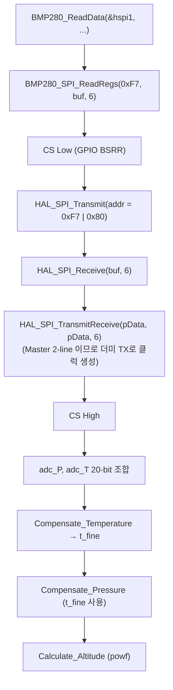
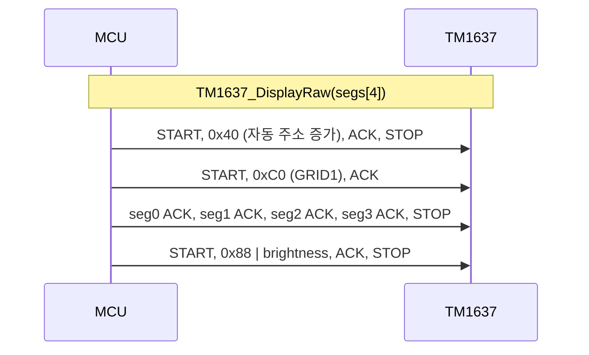

# 04. 핵심 펌웨어 구현 및 동작 원리

범례: 🟢 사용자 작성 코드 / 🔵 CubeMX 생성 코드 / ⚪ ST HAL (수정하지 않음)

| 기능 | 파일 / 함수 | 구분 |
|---|---|---|
| 주기 스케줄러 | [main.c](../Core/Src/main.c) `main()` USER CODE 2·WHILE | 🟢 |
| printf → UART | [main.c](../Core/Src/main.c) `__io_putchar()` | 🟢 |
| BH1750 드라이버 | [bh1750.c](../Core/Src/bh1750.c) | 🟢 |
| BMP280 드라이버 | [bmp280.c](../Core/Src/bmp280.c) | 🟢 |
| TM1637 드라이버 | [tm1637.c](../Core/Src/tm1637.c) | 🟢 |
| 주변장치 초기화 | [main.c](../Core/Src/main.c) `MX_*_Init`, [stm32f1xx_hal_msp.c](../Core/Src/stm32f1xx_hal_msp.c) | 🔵 |
| I2C/SPI/UART/GPIO 구현 | `Drivers/STM32F1xx_HAL_Driver/Src/*.c` | ⚪ |

---

## 1. 주기 스케줄러 (Super-loop + HAL_GetTick)

**목적**: 센서 읽기(100 ms)와 PC 출력(500 ms)을 `HAL_Delay()` 없이 분리하여 한 루프에서 처리.
**입력/출력**: `HAL_GetTick()` → 전역 캐시 `illuminance/temperature/pressure/altitude`, TM1637, UART.
**처리 방식**: 폴링 (인터럽트/DMA 없음). 부호 없는 32-bit 뺄셈 `currentTick - last >= N` 으로 틱 오버플로(약 49.7일) 시에도 올바른 경과 시간 계산.

```c
// main.c  (USER CODE WHILE)
uint32_t currentTick = HAL_GetTick();

if (currentTick - lastSenseTick >= 100) {
    lastSenseTick = currentTick;
    BH1750_ReadLux(&hi2c1, &illuminance);
    if (BMP280_ReadData(&hspi1, &temperature, &pressure, &altitude) == HAL_OK) {
        int16_t press_int = (int16_t)(pressure + 0.5f);
        if (press_int != lastDisplayedPress) {          // Dirty check
            lastDisplayedPress = press_int;
            TM1637_DisplayDecimal(press_int, false);
        }
    }
}
if (currentTick - lastUartTick >= 500) {
    lastUartTick = currentTick;
    printf("[ALL SENSORS] Lux: %6.1f lx | Temp: %6.3f C | Press: %8.3f hPa | Altitude: %6.3f m\r\n", ...);
}
```

**설계 의도**
- UART 출력(약 90바이트 ≈ 이론 7.8 ms blocking)이 센서 읽기를 지연시키지 않도록 로그는 *캐시된 값*만 출력.
- TM1637 갱신은 이론상 수 ms 의 블로킹 비트뱅잉이므로(아래 §4) 값이 변할 때만 수행.

**한계**: `BH1750_ReadLux()`의 반환값을 확인하지 않아 실패 시 이전 값이 유지됨 → [05_troubleshooting.md](05_troubleshooting.md) 이슈 2.

---

## 2. BMP280 SPI 드라이버

### 2-1. 호출 흐름



### 2-2. 레지스터 접근 규약 (코드)

```c
// bmp280.c
tx[0] = (uint8_t)(reg & 0x7F);     // Write: bit7 = 0
...
uint8_t addr = (uint8_t)(reg | 0x80); // Read : bit7 = 1
BMP280_CS_Low();
HAL_SPI_Transmit(hspi, &addr, 1, 10);
HAL_SPI_Receive(hspi, data, length, 10);   // CS를 유지한 채 연속 수신
BMP280_CS_High();
```

### 2-3. 초기화 시퀀스 (`BMP280_Init`)

| 순서 | 동작 | 값 |
|---|---|---|
| 1 | `ID(0xD0)` 읽기 → 0x58 아니면 `HAL_ERROR` | `BMP280_CHIP_ID` |
| 2 | `RESET(0xE0) ← 0xB6`, `HAL_Delay(10)` | soft reset |
| 3 | `0x88`부터 24바이트 → `dig_T1..T3`, `dig_P1..P9` | little-endian 파싱 |
| 4 | `CONFIG(0xF5) ← 0x28` | t_sb = 001b(코드 주석: 62.5 ms), filter = 010b(주석: 4) |
| 5 | `CTRL_MEAS(0xF4) ← 0x57` | osrs_t=010b(×2), osrs_p=101b(×16), mode=11b(Normal) |

> 비트 필드 의미(t_sb, filter, osrs)는 코드 주석 기준이며, 레지스터 비트 정의는 BMP280 데이터시트의 해당 레지스터 절에서 재확인이 필요합니다(페이지 미확인).

### 2-4. HAL → 레지스터 → 신호 추적 (`HAL_SPI_Transmit`, `stm32f1xx_hal_spi.c:795`)

1. 사용자: `HAL_SPI_Transmit(&hspi1, &addr, 1, 10)` — `Size==1`.
2. HAL 구현: 상태 `READY` 확인 → `__HAL_LOCK` → `SPE` 비트 미설정이면 `__HAL_SPI_ENABLE`.
3. 8-bit 모드 & `initial_TxXferCount == 1` 분기에서 `*(__IO uint8_t*)&SPI1->DR = *pTxBuffPtr` (`SPI_DR` 쓰기).
4. MCU 하드웨어: 마스터가 `SPI_CR1.BR`(÷8) 클럭으로 SCK(PA5)를 8펄스 발생, MOSI(PA7)로 MSB부터 전송. Mode 3이므로 SCK idle High.
5. `SPI_EndRxTxTransaction`이 `TXE`=1 및 `BSY`=0 대기 → 전송 완료. 수신 데이터는 읽지 않으므로 `OVR` 플래그를 지움 (`__HAL_SPI_CLEAR_OVRFLAG`).
6. `HAL_SPI_Receive` (`:961`): Master+2LINES이면 **`HAL_SPI_TransmitReceive(hspi, pData, pData, Size, Timeout)`로 위임** → 더미 바이트를 TX하여 SCK를 생성하고 `RXNE` 시 `DR`을 읽음. 이것이 센서 → MCU 데이터(MISO, PA6)가 들어오는 경로.
7. 외부: BMP280이 주소(bit7=1)를 해석하여 0xF7부터 자동 증가 주소로 6바이트를 MISO에 출력.

### 2-5. 보정 계산

```c
// bmp280.c : BMP280_ReadData
int32_t adc_P = ((uint32_t)raw[0] << 12) | ((uint32_t)raw[1] << 4) | (raw[2] >> 4);   // 20-bit
int32_t adc_T = ((uint32_t)raw[3] << 12) | ((uint32_t)raw[4] << 4) | (raw[5] >> 4);
float temp_val  = BMP280_Compensate_Temperature(adc_T);  // calibData.t_fine 갱신
float press_val = BMP280_Compensate_Pressure(adc_P);     // t_fine 사용 → 반드시 온도 먼저
*altitude = 44330.0f * (1.0f - powf(press_val / current_sea_level_hPa, 0.1902949f));
```

- 보정식: 데이터시트 부동소수점(double) 버전 (코드 주석 "데이터시트 8.1 공식"). Cortex-M3는 FPU가 없어(`-mfloat-abi=soft`) double 연산은 소프트웨어 라이브러리로 수행되며 **Flash 사용량 증가 요인** (map 상 `.text` 약 36 KB 중 비중은 미분석).
- 고도: 국제 표준 대기 근사식. 기준 해면기압은 `current_sea_level_hPa` (초기값 `BMP280_SEA_LEVEL_HPA = 1013.25`).

---

## 3. BH1750 I2C 드라이버

```c
// bh1750.c
HAL_I2C_IsDeviceReady(hi2c, BH1750_I2C_ADDR, 3, 100);         // 존재 확인
HAL_I2C_Master_Transmit(hi2c, ADDR, &cmd(0x01), 1, 100);      // Power On
HAL_I2C_Master_Transmit(hi2c, ADDR, &cmd(0x10), 1, 100);      // Continuous H-Resolution
...
HAL_I2C_Master_Receive(hi2c, ADDR, buffer, 2, 100);
*lux = (float)(((uint16_t)buffer[0] << 8) | buffer[1]) / 1.2f;
```

### HAL → 레지스터 → 신호 추적 (`HAL_I2C_Master_Receive`, `stm32f1xx_hal_i2c.c:1195`)

| 단계 | HAL 동작 (소스 확인) | 레지스터 | 버스 상 결과 |
|---|---|---|---|
| 1 | `BUSY` 플래그 해제 대기 (`I2C_WaitOnFlagUntilTimeout`) | `I2C_SR2.BUSY` | 버스 유휴 확인 |
| 2 | `PE` 미설정 시 활성화 | `I2C_CR1.PE` | |
| 3 | `I2C_MasterRequestRead` (`:6751`): `ACK`=1, `START`=1, `SB` 대기 후 `DR = (addr<<1)\|1` | `CR1.ACK/START`, `SR1.SB`, `DR` | START + 0x47 (주소 0x23, Read) |
| 4 | `XferSize==2` 분기: `POS`=1, `__disable_irq`, `ADDR` 클리어, `ACK`=0, `__enable_irq` | `CR1.POS/ACK`, `SR1/SR2` | 2바이트 수신 시퀀스 (RM0008 규정 절차) |
| 5 | `BTF` 대기 → `STOP`=1 → `DR`을 2회 읽음 | `SR1.BTF`, `CR1.STOP`, `DR` | 상위/하위 바이트 수신, 마지막에 NACK + STOP |
| 6 | 반환 `HAL_OK` | | |

- 2바이트 전용 분기가 존재하는 이유: STM32F1 I2C 마스터 수신은 N=1, N=2, N≥3 별로 ACK/STOP 타이밍이 다름 (HAL 코드 내 `EV6_3` 주석 확인). 그래서 인터럽트를 잠깐 끄는 구간이 있음.
- 상위 바이트 우선(`buffer[0] << 8`) 조합은 코드 기준이며, 데이터시트의 바이트 순서/나눗셈 1.2와의 일치는 BH1750 데이터시트에서 확인 필요(페이지 미확인).

---

## 4. TM1637 비트뱅잉 드라이버

### 4-1. 전송 프로토콜 구현



```c
// tm1637.c : TM1637_WriteByte (발췌)
for (uint8_t i = 0; i < 8; i++) {
    CLK_Low();  delay;
    if (data & 0x01) DIO_High(); else DIO_Low();   // LSB first
    delay;  CLK_High();  delay;
    data >>= 1;
}
CLK_Low(); DIO_High();  delay;      // DIO 해제 (Open-Drain)
CLK_High(); delay;
uint8_t ack = DIO_Read();           // 9번째 클럭에서 TM1637이 Low로 당기면 ACK
CLK_Low();  delay;
return (ack == 0);
```

- `CLK_High()` 등은 `HAL_GPIO_WritePin` → `GPIOx->BSRR` 쓰기 (`stm32f1xx_hal_gpio.c:465`), `DIO_Read()`는 `GPIOx->IDR` 읽기 (`:431`). HAL 주석대로 BSRR은 원자적이므로 인터럽트(SysTick)와 충돌해도 다른 핀 비트가 깨지지 않음.
- 지연: `TM1637_DelayUs(25)` = `volatile` 카운터를 `us*16`회 감소. **캘리브레이션 근거는 소스에 없음**(주석: "RC 필터 충전 보장 딜레이"). `-O0` 빌드에서 루프 1회의 사이클 수에 따라 실제 시간이 결정되므로 **실측 필요**.
- 이론적 최소 시간 (지연이 정확히 25 µs라 가정 시): 비트당 지연 3회=75 µs, 바이트(8비트+ACK 2회) ≈ 650 µs, `DisplayRaw`는 7바이트 + Start/Stop → 약 5 ms. 이 값은 **계산값이며 측정값이 아님**.
- ACK 실패(`WriteByte`가 false)해도 `DisplayRaw`는 결과를 확인하지 않고 진행함 (반환값 무시).

### 4-2. 표시 변환

`TM1637_DisplayDecimal(num, leadingZero)`: 부호 처리 → 9999로 clamp → 자릿수별 `digitFont[]` 7-segment 코드로 변환 → `segs[0..3]`(왼쪽부터). 현재 `main.c`는 `leadingZero=false`로 호출하며 기압(hPa) 정수만 표시합니다.

---

## 5. printf → UART 경로

```c
// main.c
void __io_putchar(int ch) {
    if (ch == '\n') HAL_UART_Transmit(&huart2, (uint8_t*)"\r", 1, 0xffff);
    HAL_UART_Transmit(&huart2, (uint8_t*)&ch, 1, 0xffff);
}
```

호출 체인: `printf` → newlib `_write` ([syscalls.c:80](../Core/Src/syscalls.c), `__io_putchar` 호출) → `HAL_UART_Transmit` (`stm32f1xx_hal_uart.c:1138`).

HAL 동작: `gState` READY 확인 → `TXE` 대기 → `USART2->DR = byte` → `TC` 대기. 한 글자마다 호출되므로 한 줄(약 90 B) 전송 중 CPU는 완전 블로킹 (115200 bps 이론 ≈ 87 µs/바이트).

> 참고: 문자열 자체가 이미 `"\r\n"`을 포함하므로 `'\n'`에서 `\r`이 한 번 더 전송됨 (`\r\r\n`). 터미널 표시에는 영향이 없을 수 있으나 불필요한 바이트입니다.
> 참고: ST 템플릿의 선언은 `int __io_putchar(int)` 이고 본 코드는 `void` 로 정의되어 시그니처가 다릅니다 (링크는 되지만 규약과 불일치).

---

## 6. 실행 결과

실기 로그는 프로젝트에 없습니다. 코드상 출력 형식은 다음과 같습니다 (**예시 형식이며 실측값이 아님**):

```
[ALL SENSORS] Lux:  123.4 lx | Temp: 25.123 C | Press: 1013.250 hPa | Altitude: 12.345 m
```

TM1637: 부팅 시 `TEST` → `GOOD`(또는 `ERR `) → 이후 기압 정수(hPa).
