# 05. 트러블슈팅 및 문제 해결

이 문서는 네 부분으로 구성됩니다.

1. **[실제 사례 1] BMP280 SPI 통신 실패** — 오실로스코프와 보드 회로도로 찾은 하드웨어 배선 문제
2. **[실제 사례 2] 고도가 음수로 출력** — 계산식 역산으로 찾은 기준값 문제
3. **설계 단계에서 대응한 문제** — 코드 구조로 미리 막아 둔 문제
4. **소스·데이터시트 리뷰에서 발견한 이슈** — 아직 수정하지 않은 개선점

---

## 1. [실제 사례 1] BMP280 SPI 통신 실패 — NUCLEO 모르포 핀 오배선

### 한눈에 보기

| 항목 | 내용 |
|---|---|
| **증상** | 부팅 시 TM1637에 `ERR ` 표시, Tera Term에 `[SPI1] BMP280 Sensor Initialization FAILED!` 출력 |
| **결정적 단서** | 오실로스코프로 BMP280 쪽을 측정하니 **CSB는 High → Low → High로 정상 동작하는데 SCK에는 클럭이 전혀 없음** |
| **근본 원인** | 모르포 커넥터 CN10-26/28/30에 SPI 3선을 연결했는데, NUCLEO-**F103RB**에서는 이 핀들이 솔더 브리지 설정상 **PA7/PA6/PA5가 아니라 PB15/PB14/PB13**에 연결되어 있음 |
| **해결** | SPI 3선을 실제로 PA7/PA6/PA5가 연결된 **CN10-15/13/11**(Arduino D11/D12/D13)로 이동 |
| **사용 도구** | 멀티미터, 2채널 오실로스코프(Agilent DSO3152A), NUCLEO 보드 회로도(MB1136) |
| **교훈** | 개발 보드의 핀은 MCU 핀 이름이 아니라 **보드 회로도와 솔더 브리지(SB) 상태**로 확인해야 한다 |

### 1-1. 증상

- 7-segment: 부팅 자가 진단 결과 `ERR ` 표시 (BH1750은 정상, BMP280 초기화 실패)
- UART 로그: `[SPI1] BMP280 Sensor Initialization FAILED! Check SPI1 Wiring (PA4~PA7).`
- 펌웨어 동작: `BMP280_Init()`이 Chip ID 레지스터(0xD0)를 읽었을 때 `0x58`이 아니어서 `HAL_ERROR`를 반환 (`bmp280.c`)

> SPI는 상대 장치가 없어도 `HAL_SPI_Receive()`가 `HAL_OK`를 반환합니다. **Chip ID 검증이 있었기 때문에** "통신 함수는 성공했지만 실제로는 센서와 대화하지 못한" 상태를 초기화 단계에서 잡을 수 있었습니다.

### 1-2. 디버깅 과정

| 단계 | 의심한 원인 | 확인 방법 | 결과 | 판단 |
|---|---|---|---|---|
| ① | 전원·납땜 불량 (모듈 헤더를 직접 납땜) | 멀티미터로 5V·GND 납땜 상태 확인 | 정상 | 전원 문제 제외 |
| ② | 배선 실수 | 보드 핀맵 기준으로 NUCLEO ↔ 모듈 핀 매칭 재확인 | 당시 기준으로는 일치 | 배선은 맞다고 판단 (이후 ⑥에서 오류로 밝혀짐) |
| ③ | SPI 신호가 안 나옴 | 오실로스코프 **CH1 = BMP280 SCK**, **CH2 = BMP280 CSB** | **CSB는 High → Low → High 정상, SCK는 변화 없음** | 칩 선택은 되는데 클럭이 센서에 도달하지 않음 |
| ④ | 프로브 불량 | CH1 프로브로 CSB를 측정해 프로브 동작 확인 → 다시 CH1을 SCK에 연결 | CH1로도 CSB 토글은 정상으로 보이지만, SCK는 여전히 변화 없음 | 프로브 문제 제외 |
| ⑤ | BMP280 모듈 고장 | — | — | 모듈 고장을 의심하며 보드 회로도를 다시 확인 |
| (펌웨어) | SPI 설정·속도 문제 | 원래 설정(Mode 3, 8 MHz)을 **Mode 0, 1 MHz**(64 MHz / 64)로 낮추고, `BMP280_Init()`에 **Chip ID 값을 UART로 출력**하는 코드 추가 | 배선이 잘못된 상태에서는 설정과 무관하게 실패 | 펌웨어 쪽 변수를 줄이고 결과를 눈으로 확인하기 위한 조치 |
| ⑥ | **보드 내부 연결** | NUCLEO 회로도(MB1136)에서 PA6 경로 추적 → 보드의 솔더 브리지 육안 확인 | PA6가 **두 경로**로 표기됨. CN10-28 쪽 **SB39는 비어 있음(OPEN)**, CN10-13 쪽 **SB41은 0 Ω으로 연결됨** | CN10-28은 PA6가 아님 → 같은 구조인 26/30도 확인 |
| ⑦ | — | SPI 3선을 CN10-15/13/11로 이동 | **정상 동작** | 원인 확정 |

#### 측정 환경

| 측정 셋업 | PA4(CSB) 핀 직접 측정 |
|---|---|
| 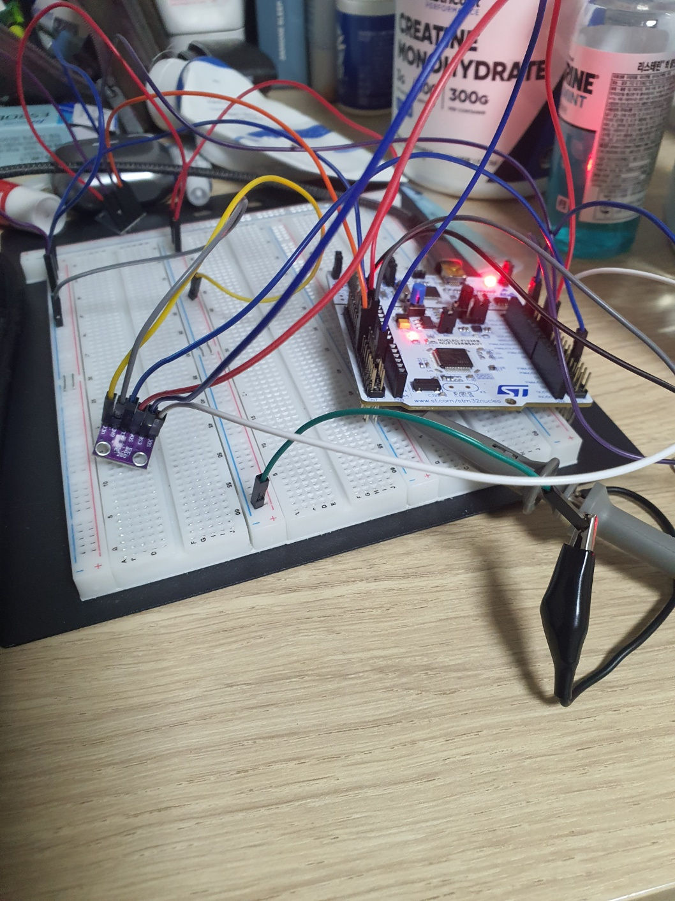 | 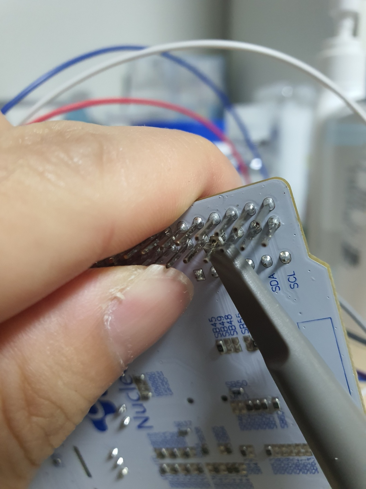 |
| 브레드보드 위 BMP280 모듈에 프로브 연결 | 모르포 헤더 뒷면에서 PA4(CSB) 핀에 프로브를 대어 확인 |

#### 오실로스코프 측정 (수정 전)

**③ 2채널 측정 — CSB는 동작하는데 SCK는 없음**

| 초기 측정 (500 µs/div) | CSB만 표시 (CH2, 20 µs/div) | **CSB와 SCK 동시 비교** (20 µs/div) |
|---|---|---|
| 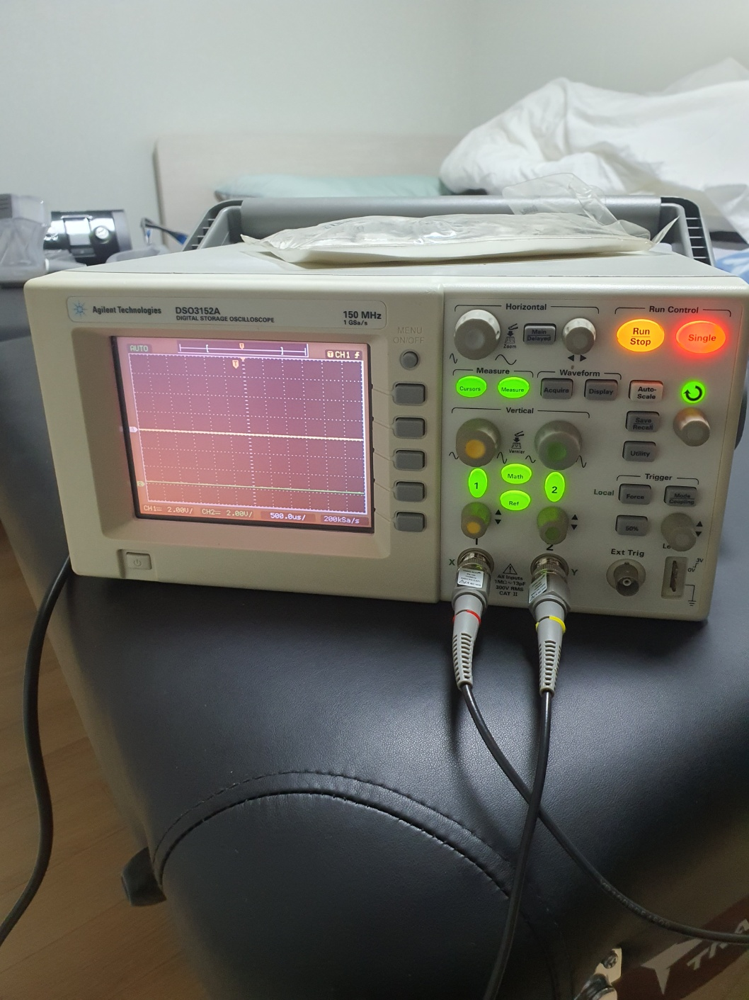 | 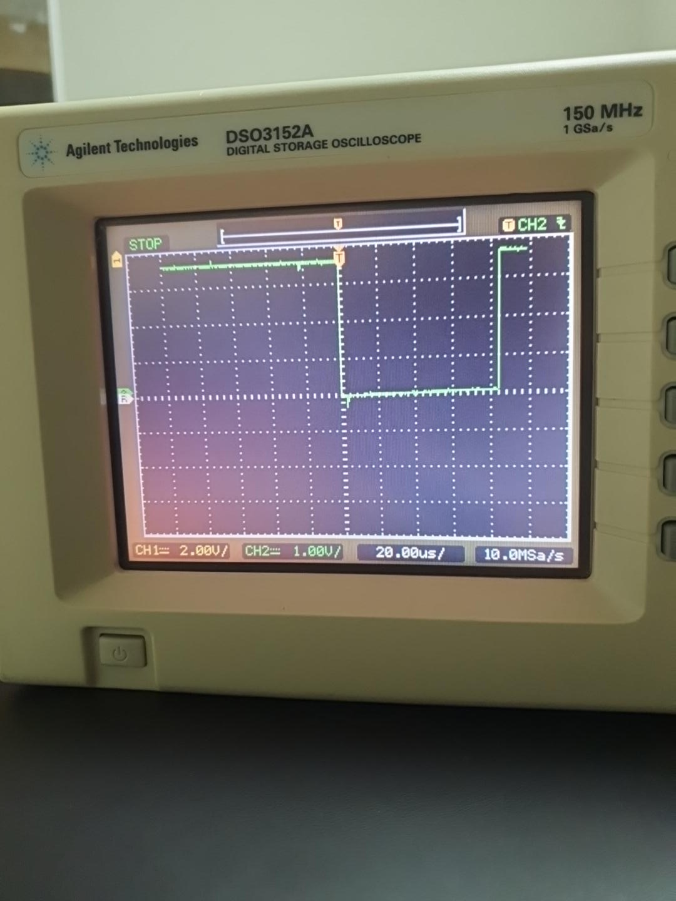 | 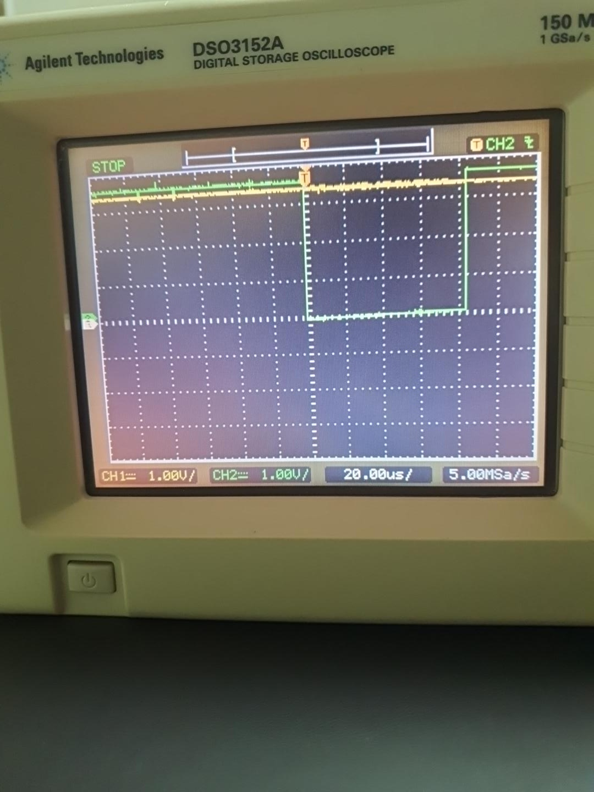 |
| CH1(SCK), CH2(CSB) 모두 평평하게 보임. 시간 축이 넓어 짧은 CS 구간이 화면에 잡히지 않음 | 트리거를 **CH2(CSB) 하강 에지**로 바꾸자 CSB가 High → Low → High로 토글하는 것이 보임 (Low 구간 약 50 µs, 화면 눈금 기준) | **CSB(초록)가 Low인 동안 SCK(노랑)는 High에서 전혀 움직이지 않음.** 이 구간에 SPI 클럭이 있어야 함 |

**④ 프로브 점검 — CH1 프로브는 정상**

| CH1으로 CSB 측정 (20 µs/div) | CH1을 다시 SCK에 연결 (10 µs/div) |
|---|---|
| 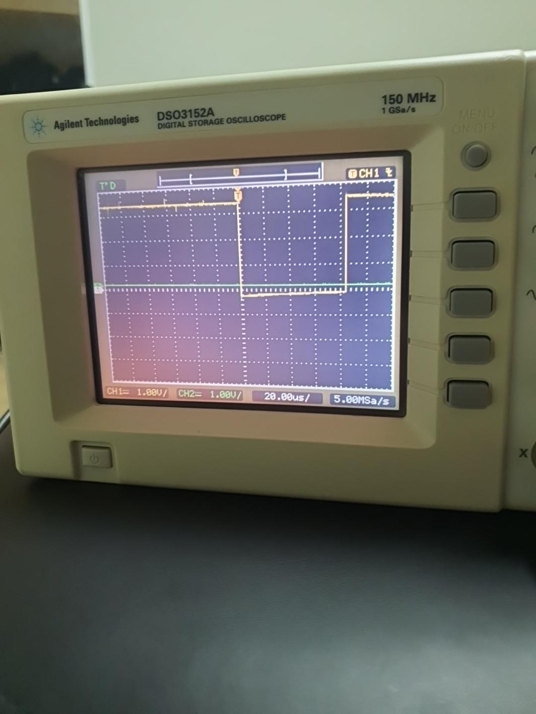 | 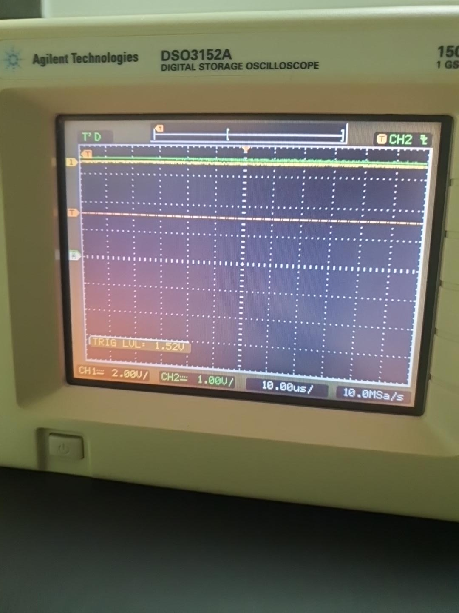 |
| CH1 프로브로 CSB를 재면 High → Low → High가 정상으로 보임 → **프로브와 채널은 정상** | 같은 프로브로 SCK를 재도 평평함 → 문제는 측정 장비가 아니라 **SCK 신호 자체** |

### 1-3. 근본 원인

NUCLEO-64 보드는 여러 STM32 모델이 **같은 PCB**를 쓰고, 모델마다 **솔더 브리지(SB)**로 핀 연결을 바꿉니다. 회로도의 CN10-26/28/30 옆에는 PA7/PA6/PA5가 함께 표기되어 있지만, 이 연결은 **F302R8 전용**입니다.

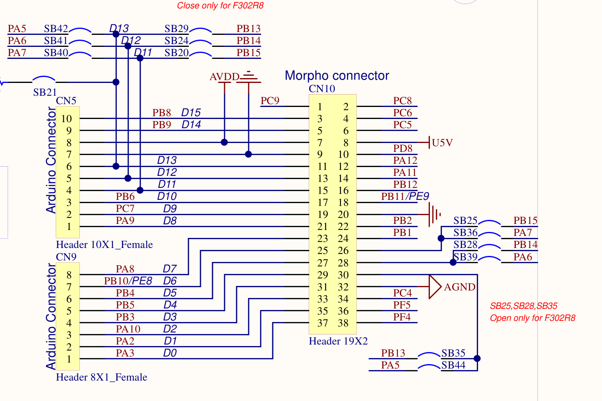

*출처: ST NUCLEO-64 보드 회로도 MB1136 (CN5/CN9 Arduino 커넥터, CN10 모르포 커넥터). 오른쪽 아래 주석 "SB25, SB28, SB35 Open only for F302R8"*

| CN10 핀 | 의도한 신호 | F103RB에서 실제 연결 | 솔더 브리지 |
|---|---|---|---|
| 26 | MOSI (PA7) | **PB15** | SB25 연결 / SB36 OPEN |
| 28 | MISO (PA6) | **PB14** | SB28 연결 / **SB39 OPEN (보드에서 육안 확인)** |
| 30 | SCK (PA5) | **PB13** | SB35 연결 / SB44 OPEN |

→ 펌웨어는 SPI1을 PA5/PA6/PA7로 구동했지만, 센서 선은 **설정되지 않은 PB13/PB14/PB15**에 꽂혀 있었습니다.

**관찰 결과가 모두 이 원인으로 설명됩니다.**

| 관찰 | 설명 |
|---|---|
| CSB는 정상 토글 | PA4(CS)는 올바른 핀에 연결되어 있었고, 펌웨어가 GPIO로 직접 제어하므로 정상 |
| SCK에 클럭 없음 | 센서 SCK 선이 PA5가 아닌 PB13에 연결 → PA5에서 나온 클럭이 센서까지 가지 않음 |
| Chip ID ≠ 0x58 | 클럭도, MOSI 주소도 센서에 도달하지 않고 MISO도 MCU에 돌아오지 않음 → `BMP280_Init()` 실패 |

### 1-4. 해결

SPI 3선을 PA5/PA6/PA7이 **모든 NUCLEO-64 모델에서 공통으로** 연결되는 Arduino 헤더 신호(D13/D12/D11) 위치로 옮겼습니다.

| 신호 | 수정 전 | 수정 후 | 보드 내부 경로 |
|---|---|---|---|
| SCK (PA5) | CN10-30 | **CN10-11** (D13) | SB42 |
| MISO (PA6) | CN10-28 | **CN10-13** (D12) | SB41 |
| MOSI (PA7) | CN10-26 | **CN10-15** (D11) | SB40 |

원인은 배선이었으므로 펌웨어의 SPI 로직은 바꾸지 않았습니다. 배선을 고친 뒤 디버깅 중 바꿨던 SPI 설정을 두 가지 모두 시험했습니다.

| SPI 설정 | CPOL / CPHA | 클럭 | 결과 |
|---|---|---|---|
| 디버깅용 설정 | Mode 0 (0 / 0) | 64 MHz / 64 = 1 MHz | 정상 동작 (Chip ID `0x58`, 기압 표시) |
| **최종 설정** | **Mode 3 (1 / 1)** | **64 MHz / 8 = 8 MHz** | **정상 동작** |

BMP280은 데이터시트상 SPI Mode '00'과 '11'을 모두 지원하고(CSB 하강 직후 SCK 레벨로 자동 판별, 5.3절 p.30), 최대 10 MHz까지 동작합니다(p.2). 두 설정이 모두 동작한 결과가 이 사양과 일치하며, 최종 펌웨어는 원래 설계대로 **Mode 3 / 8 MHz**로 되돌렸습니다. 디버깅 중 추가한 Chip ID 출력은 초기화 진단용으로 남겼습니다.

### 1-5. 검증

| 수정 후 SPI 파형 ① (2 µs/div) | 수정 후 SPI 파형 ② (2 µs/div) |
|---|---|
| 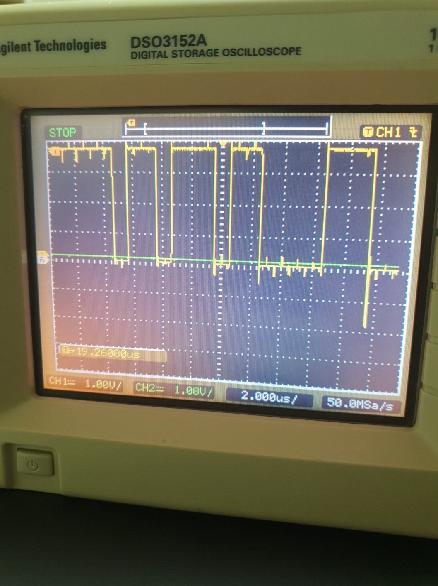 | 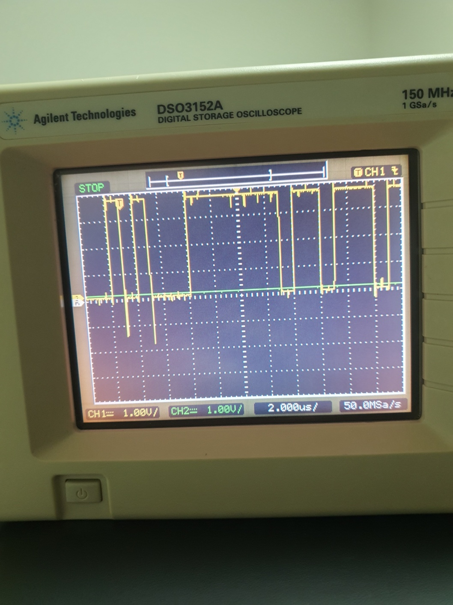 |
| CH1(노랑) = 데이터선(MOSI로 추정). 수정 전에는 변화가 없던 SPI 라인에 데이터 파형이 나타남 | 반복 측정에서도 동일하게 신호 확인 |

> CH2(초록)는 이 측정에서 프로브를 분리한 상태라 평평한 선은 의미 없는 신호입니다. 사진에는 클럭(SCK)이 함께 찍히지 않아 바이트 경계를 알 수 없으므로, CH1이 MOSI인지 MISO인지는 파형만으로 단정하지 않았습니다.

- 7-segment에 기압 값이 표시됨 ([02_hardware.md](02_hardware.md)의 전체 배선 사진: `1018` hPa)
- 측정 데이터 로그는 [06_testing_and_results.md](06_testing_and_results.md)에 정리

### 1-6. 배운 점과 재발 방지

1. **개발 보드 핀은 보드 회로도 + 솔더 브리지 상태로 확인한다.** 같은 PCB를 쓰는 보드는 모델마다 핀 연결이 다를 수 있다. 이후 핀 배정 시 MB1136 회로도의 SB 주석을 먼저 확인한다.
2. **신호의 양 끝을 비교한다.** CSB는 보이는데 SCK만 없다는 비교가 "펌웨어 문제가 아니라 경로 문제"라는 판단의 근거가 됐다. 다음에는 **MCU 핀(PA5) 쪽과 센서 쪽을 함께 측정**해 더 빨리 경로 단절을 찾을 수 있다.
3. **오실로스코프는 트리거 설정이 핵심이다.** 500 µs/div 자동 모드에서는 수 µs 길이의 CS 구간이 보이지 않았고, CSB 하강 에지 트리거로 바꾼 뒤에야 의미 있는 비교가 가능했다.
4. **부품 고장은 마지막에 의심한다.** 모듈 고장을 의심했지만, 교체 전에 회로도를 다시 본 덕분에 실제 원인을 찾았다.
5. **초기화 단계의 ID 검증은 필수다.** Chip ID 검사가 없었다면 SPI 함수는 성공으로 끝나고, 잘못 읽힌 보정 계수로 계산된 엉뚱한 기압이 출력되어 원인 파악이 더 어려웠을 것이다.
6. **디버깅 중 바꾼 설정은 원인을 찾은 뒤 원래대로 되돌려 검증한다.** 속도를 낮춘 설정에서만 동작하는지, 원래 설정에서도 동작하는지를 나눠 확인해야 "속도 문제"와 "배선 문제"를 구분할 수 있다.

---

## 2. [실제 사례 2] 고도가 음수로 출력 — 기준 기압 미설정

### 한눈에 보기

| 항목 | 내용 |
|---|---|
| **증상** | 책상 위에서 측정한 고도가 **−42.7 m**로 출력 |
| **결정적 단서** | 로그의 기압 값을 고도 공식에 직접 넣어 계산하니 **로그와 같은 −42.76 m**가 나옴 → 계산 코드는 정상 |
| **근본 원인** | 기준 기압(P0)이 기본값 **1013.25 hPa**로 남아 있었고, 측정 기압(**1018.4 hPa**)이 이보다 높아 "해수면보다 낮은 위치"로 계산됨. 현지 기준값용 상수 `LOCAL_SEA_LEVEL_HPA`(1023.4)는 **정의만 되고 호출되지 않음** |
| **해결** | 부팅 직후 첫 측정 완료(50 ms)를 기다려 그 기압을 기준 기압으로 설정 → **부팅 위치 = 0 m인 상대 고도** |
| **교훈** | 숫자가 이상할 때 **계산이 틀린 것인지, 입력(기준값)이 틀린 것인지**를 먼저 나눠 본다 |

### 2-1. 증상

```
[SPI1] BMP280 chip ID: 0x58
[SPI1] BMP280 Sensor Initialized! (SeaLevel QNH: 1013.25 hPa)
[ALL SENSORS] Lux:    6.7 lx | Temp: 23.972 C | Press: 1018.397 hPa | Altitude: -42.768 m
[ALL SENSORS] Lux:    5.8 lx | Temp: 23.960 C | Press: 1018.390 hPa | Altitude: -42.710 m
[ALL SENSORS] Lux:    5.0 lx | Temp: 23.957 C | Press: 1018.383 hPa | Altitude: -42.646 m
```

온도와 기압은 실내 값으로 자연스럽지만, 고도만 음수입니다.

### 2-2. 원인 분석

**① 계산식 검증 — 로그 값을 공식에 직접 대입**

고도 공식(`bmp280.c: BMP280_Calculate_Altitude`): `h = 44330 × (1 − (P / P0)^0.1903)`

| 측정 기압 P (로그) | 기준 기압 P0 | 직접 계산한 고도 | 로그의 고도 |
|---|---|---|---|
| 1018.397 hPa | 1013.25 hPa | **−42.76 m** | −42.768 m |
| 1018.390 hPa | 1013.25 hPa | −42.71 m | −42.710 m |
| 1018.383 hPa | 1013.25 hPa | −42.65 m | −42.646 m |

계산 결과가 로그와 일치합니다(차이는 로그의 소수점 표시 반올림). **기압 측정과 고도 계산 코드는 정상**이고, 문제는 입력값인 P0입니다.

**② 코드 확인 — 기준 기압이 어디서 정해지는가**

- `bmp280.c`: `current_sea_level_hPa`의 초기값은 `BMP280_SEA_LEVEL_HPA` = **1013.25 hPa** (국제 표준 대기압)
- `main.c`: `#define LOCAL_SEA_LEVEL_HPA 1023.4f`가 있지만 **`BMP280_SetSeaLevelPressure()`를 호출하는 곳이 없음** → 상수가 사용되지 않음
- 부팅 로그의 `SeaLevel QNH: 1013.25 hPa`가 이를 그대로 보여줌

**③ 물리적 의미**

P > P0이면 `(P / P0)^0.1903 > 1`이 되어 고도가 음수가 됩니다. 기준 기압은 **날씨에 따라 매일 바뀌는 값**이라서 고정 상수로는 맞출 수 없습니다. 해수면 근처에서 기압 1 hPa 차이는 약 **8.3 m**에 해당하므로(44330 × 0.1903 / 1013.25), 기준값이 5 hPa만 달라도 고도가 40 m 넘게 틀어집니다. 실제로 사용되지 않던 1023.4 hPa를 넣으면 같은 측정값이 **+41.3 m**가 됩니다.

### 2-3. 해결 방법 비교

| 방법 | 원리 | 장점 | 단점 |
|---|---|---|---|
| **A. 부팅 시 0점 (채택)** | 부팅 직후 기압을 P0로 설정 | 외부 자료 불필요, 층 이동 같은 **높이 변화** 측정에 적합 | 절대 해발고도가 아님. 날씨 변화로 0점이 서서히 이동 |
| B. 그날의 해면기압 입력 | 기상청 관측 해면기압을 상수로 입력 | 표준 방식의 절대 고도 | 날씨가 바뀔 때마다 재빌드 필요 |
| C. 알려진 높이로 역산 | P0 = P ÷ (1 − h0/44330)^(1/0.1903) | 한 번 맞추면 절대 고도 | 장소의 실제 높이를 알아야 함 |
| D. UART 명령으로 설정 | 실행 중 0점·기준값 변경 | 재빌드 불필요 | UART 수신 기능 추가 필요 |

이 프로젝트는 기압과 높이 변화를 보여주는 데모이므로 **A(상대 고도)**를 선택했습니다.

### 2-4. 구현

`bmp280.c`에 `BMP280_ZeroAltitude()`를 추가하고, `main.c`에서 초기화 성공 직후 한 번 호출합니다. 사용하지 않던 `LOCAL_SEA_LEVEL_HPA`는 삭제했습니다.

```c
HAL_StatusTypeDef BMP280_ZeroAltitude(SPI_HandleTypeDef *hspi)
{
    float press = 0.0f;

    // 첫 측정 결과가 데이터 레지스터의 리셋값을 덮어쓸 때까지 대기 (max 43.2 ms + 여유)
    HAL_Delay(BMP280_ZERO_SETTLE_MS);                 // 50 ms

    // 센서는 측정 주기(약 106 ms)마다 한 번만 값을 갱신 → 1회만 읽음
    HAL_StatusTypeDef status = BMP280_ReadData(hspi, NULL, &press, NULL);
    if (status != HAL_OK || press <= 0.0f)
    {
        return HAL_ERROR;                             // 실패 시 기준값 유지
    }

    BMP280_SetSeaLevelPressure(press);                // P0 = 현재 기압 → h = 0
    return HAL_OK;
}
```

**타이밍 근거 (BMP280 데이터시트)**

| 항목 | 값 | 근거 |
|---|---|---|
| 현재 설정 | osrs_p ×16, osrs_t ×2 ("Ultra high resolution"), t<sub>standby</sub> 62.5 ms, IIR 계수 4 — 데이터시트 권장 사용 사례 **"handheld device low-power (e.g. Android)"**와 동일 (ODR 10 Hz, RMS 잡음 **4.0 cm**) | `BMP280_Init()`, 3.4절 Table 7, p.14 |
| 측정 시간 | typ 37.5 ms / **max 43.2 ms** | 3.8.1절 Table 13, p.18 |
| 측정 주기 | typ 37.5 + 62.5 = **100 ms (10 Hz)**, 최대 약 106 ms (이 주기마다 데이터 레지스터 1회 갱신) | Table 7, 13 + t<sub>standby</sub> |
| 대기 50 ms | 소프트 리셋 후 데이터 레지스터에는 리셋값이 들어 있음 → Normal 모드 진입 후 **첫 측정 결과가 덮어쓸 때까지(max 43.2 ms)** 기다림 | Table 13 |
| IIR 필터 대기 불필요 | 필터가 꺼진 초기 상태에서는 첫 측정값을 필터 메모리에 그대로 복사해 초기화 | 3.3.3절 Figure 2, p.12 |
| 1회만 읽음 | 측정 주기 안에서 여러 번 읽으면 모두 같은 값 → 연속 읽기로는 평균 효과 없음 | Table 13 |

부팅 시간 증가는 **약 50 ms**입니다.

> **설계 변경 기록:** 처음에는 "500 ms 안정화 + 110 ms 간격 10회 평균"(부팅 약 1.6초 증가)으로 구현했습니다. 이후 데이터시트를 다시 확인해 ① IIR 필터는 첫 측정값으로 초기화되므로 안정화 대기가 필요 없고, ② 실제 필요한 대기는 첫 측정 완료 시간(max 43.2 ms)뿐이며, ③ 측정 주기(100 ms) 안에서 연속으로 읽은 값은 모두 같아 평균 효과가 없다는 점을 근거로 **50 ms 대기 + 1회 읽기**로 단순화했습니다.

### 2-5. 검증

수정 펌웨어를 보드에 올리고, 부팅 후 보드를 크게 들어 올렸다가 책상 아래로 내리며 Tera Term 로그를 기록했습니다 (500 ms 간격 출력).

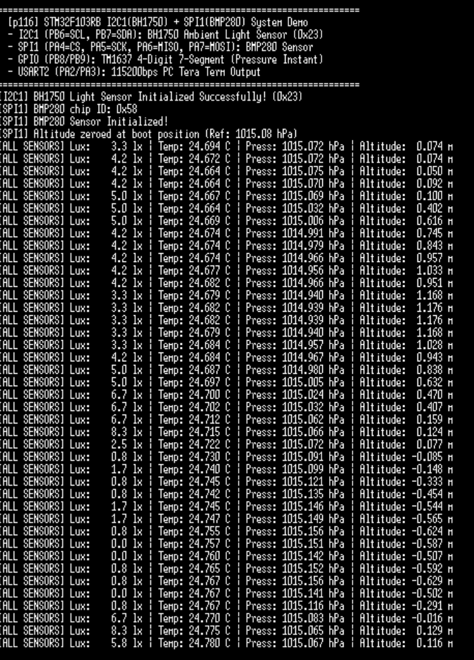

| 확인 항목 | 결과 |
|---|---|
| 부팅 0점 | `Ref: 1015.08 hPa`로 설정, 첫 출력 고도 **0.074 m** |
| 부팅 직후 구간 (움직이기 전 5줄) | **0.050 ~ 0.100 m** 범위에서 출력 |
| 들어 올림 | 기압 1014.939 hPa까지 감소, 고도 최대 **+1.176 m** |
| 내림 | 기압 1015.156 hPa까지 증가, 고도 최저 **−0.629 m** |
| 제자리 복귀 | 고도 **0.116 m** 근처로 돌아옴 |
| 수정 전과 비교 | −42.7 m → **0 m 근처에서 시작해 높이 변화를 따라감** |

- 부팅 위치가 0 m 기준이 되었고, 보드를 올리고 내리는 움직임이 고도 값의 증가·감소로 나타납니다. 기압이 낮아질 때 고도가 올라가는 방향도 공식과 일치합니다.
- 부팅 직후 구간의 변동 폭(약 5 cm)은 현재 설정의 데이터시트 RMS 잡음(4.0 cm, Table 7)과 같은 크기 수준입니다.
- 이 로그는 4장 4·5번 수정(BH1750 200 ms 주기, TM1637 CLK Open-Drain)까지 반영한 최종 펌웨어로 찍었습니다. 조도 값이 손 그림자에 따라 0.0 ~ 8.3 lx로 변하고, 7-segment 표시도 정상 동작했습니다.

### 2-6. 배운 점

1. **"계산이 틀렸나, 입력이 틀렸나"를 먼저 나눈다.** 로그 값을 공식에 직접 넣어 같은 결과가 나오면 계산 코드는 정상이고, 입력(기준값)을 의심하면 된다.
2. **정의만 되고 쓰이지 않는 설정값은 버그의 신호다.** `LOCAL_SEA_LEVEL_HPA`는 주석으로는 "현지 기준값 보정"이라고 되어 있었지만 실제로 호출되지 않았다.
3. **절대값과 상대값을 구분한다.** 기압 고도는 날씨에 따라 변하는 기준값에 의존하므로, 기준을 외부에서 받지 않는 한 상대 고도가 더 신뢰할 수 있는 값이다.

---

## 3. 설계 단계에서 대응한 문제

### 3-1. BMP280: 온도 → 기압 계산 순서 의존성

| 항목 | 내용 |
|---|---|
| 문제 | 기압 보정식이 `t_fine`(온도 보정의 중간값)을 요구함 |
| 근거 | `bmp280.c: BMP280_ReadData` 주석 "온도 먼저 계산 (t_fine 매개변수 생성을 위해 ... 반드시 먼저)" |
| 구현 | `calibData.t_fine`을 온도 함수가 갱신, 기압 함수가 사용. 호출 순서를 고정 |
| 확인 가능한 사실 | 순서가 바뀌면 `t_fine`이 이전 샘플 값이 되어 기압이 어긋나는 구조 (코드 구조에서의 해석) |
| 학습 포인트 | 센서 보정 알고리즘의 상태 의존성을 드라이버 API(`ReadData` 일괄 읽기)로 은닉 |

### 3-2. TM1637: ACK 읽기를 위한 DIO Open-Drain 설정

| 항목 | 내용 |
|---|---|
| 문제 | 한 선(DIO)을 MCU와 TM1637이 번갈아 구동 (ACK 구간은 TM1637이 Low 구동) |
| 근거 | `.ioc`: `PB9.GPIO_ModeDefaultOutputPP=GPIO_MODE_OUTPUT_OD`, `PB9.GPIO_PuPd=GPIO_PULLUP` → CubeMX 기본(PP)에서 OD로 변경한 흔적. 단, F1은 출력 모드에서 내부 풀업이 꺼지므로 `GPIO_PULLUP`은 실제로 적용되지 않고, High는 모듈의 외부 풀업이 만듦 ([02_hardware.md](02_hardware.md) 4-1절) |
| 구현 | ACK 직전 `DIO_High()`로 라인을 놓고 `HAL_GPIO_ReadPin`(IDR)으로 샘플링 |
| 비교 | Push-Pull이면 MCU가 High를 강하게 구동 → TM1637의 Low 구동과 충돌 가능 (일반 원리) |

### 3-3. 센싱·표시·로깅의 주기 분리

| 항목 | 내용 |
|---|---|
| 문제 | 센서 읽기, 느린 비트뱅잉 표시, blocking UART 출력이 한 루프에서 서로를 지연시킬 수 있음 |
| 구현 | `HAL_GetTick()` 차분 스케줄링, UART는 캐시 값 출력, TM1637은 값 변경 시에만 갱신 (코드 주석 "Dirty Check", "센서 통신 없이 ... 최신 센서 변수들을 출력") |

### 3-4. 초기화 실패를 사용자에게 가시화

`BH1750_Init`/`BMP280_Init`의 반환값으로 UART 메시지와 TM1637(`GOOD`/`ERR `) 표시를 분기. BMP280은 Chip ID(0x58) 불일치 시 `HAL_ERROR`를 반환하여 **배선·모듈 오류와 통신 성공을 구분**합니다 (`bmp280.c: BMP280_Init`). 이 설계가 1장(실제 사례 1)에서 문제를 바로 드러내는 역할을 했습니다.

---

## 4. 소스·데이터시트 리뷰에서 발견한 이슈

| # | 현상 (근거) | 영향 | 제안 |
|---|---|---|---|
| 1 | ~~`main.c`의 `LOCAL_SEA_LEVEL_HPA 1023.4f`가 어디서도 사용되지 않음~~ | 고도가 −42.7 m로 출력됨 | **해결** — 부팅 시 0점 설정 ([2장 실제 사례 2](#2-실제-사례-2-고도가-음수로-출력--기준-기압-미설정)) |
| 2 | ~~`BH1750_ReadLux()` 반환값을 `main.c`에서 검사하지 않음~~ | I2C 오류 시 이전 조도값이 그대로 출력되어 장애를 감지 못함 | **수정** — 반환값 검사 + 연속 실패 카운터. 5회 연속(약 1초) 실패 시 `FAILED` 1회, 복구 시 `recovered` 1회 로그. 보드에서 SDA/SCL 분리 시 `FAILED` 1회 출력 확인 (재연결 후 자동 복구는 6번) |
| 3 | ~~`__io_putchar`가 `void` 반환 (ST 템플릿은 `int`) 이고, 문자열의 `"\r\n"` + `'\n'→"\r"` 처리로 `\r`이 중복 전송~~ | 규약 불일치, 불필요 전송 | **수정** — `int` 반환, 줄바꿈 변환 제거 (문자열의 `\r\n`만 사용) |
| 4 | ~~BH1750 H-Resolution 측정 시간은 typ 120 ms / max 180 ms인데 (BH1750FVI 데이터시트 p.2) 100 ms 주기로 읽음~~ | 같은 측정값을 두 번 읽을 수 있음 (값이 틀리지는 않음) | **수정** — 조도만 200 ms 주기로 분리 (`main.c` `BH1750_READ_PERIOD_MS`) |
| 5 | ~~TM1637 CLK(PB8)를 3.3 V Push-Pull로 구동하지만 TM1637(VDD 5 V)의 V<sub>IH</sub>는 0.7 × VDD = 3.5 V (TM1637 데이터시트 p.14)~~ | 동작은 했지만 입력 High 기준에 0.2 V 못 미침 | **수정** — CLK를 Open-Drain으로 변경, 모듈 회로도의 R1 10 kΩ 풀업이 5 V High 생성 ([02_hardware.md](02_hardware.md) 4-1절) |
| 6 | 동작 중 BH1750의 SDA/SCL 선을 뺐다 다시 꽂으면 `FAILED` 로그 후 조도 값이 복구되지 않음 (보드 테스트에서 발견). **추정 원인:** 선이 빠질 때 SDA/SCL이 Low로 튀어 I2C1의 BUSY 비트가 1이 되는데, 이 비트는 STOP 조건을 감지해야만 0이 됨 (RM0008 26.6.7 I2C_SR2, PDF p.781). `HAL_I2C_Master_Receive()`는 BUSY가 25 ms 안에 풀리지 않으면 통신 없이 `HAL_BUSY`를 반환 (`stm32f1xx_hal_i2c.c:1205`) | 조도 값이 마지막 값으로 고정, 재부팅해야 복구 | 버스 복구(SCL 최대 9클럭 + STOP 생성) → SWRST로 I2C 리셋 (RM0008 26.6.1 I2C_CR1, PDF p.772: BUSY 잠금 해제 용도) → `HAL_I2C_Init` + `BH1750_Init`. 현재는 미적용 (실패 시 반환 상태 코드로 원인 확인도 다음 단계) |

> 1번은 실제 보드에서 증상이 나타나 2장에서 해결했습니다. 2~5번은 코드·데이터시트 분석으로 확인한 사실이며, 실제 장비에서 증상을 재현하지는 않았습니다. 이 중 2·3번은 코드 리뷰 결과로, 4·5번은 데이터시트 근거로 코드를 수정했습니다. 4·5번은 수정 후 보드에서 조도 갱신과 7-segment 표시가 정상 동작함을 확인했습니다 ([2-5절 로그](#2-5-검증)). 6번은 2번 수정을 보드에서 시험하다 발견한 이슈로, 원인은 레퍼런스 매뉴얼과 HAL 코드로 추정한 것이며 아직 수정하지 않았습니다.
