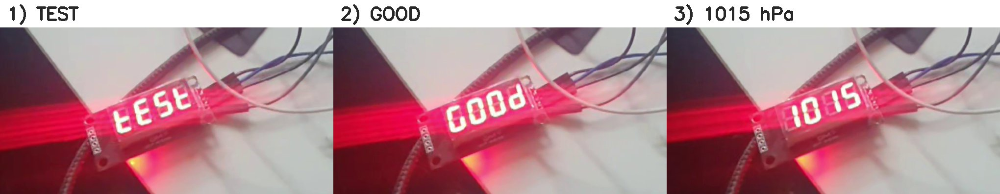
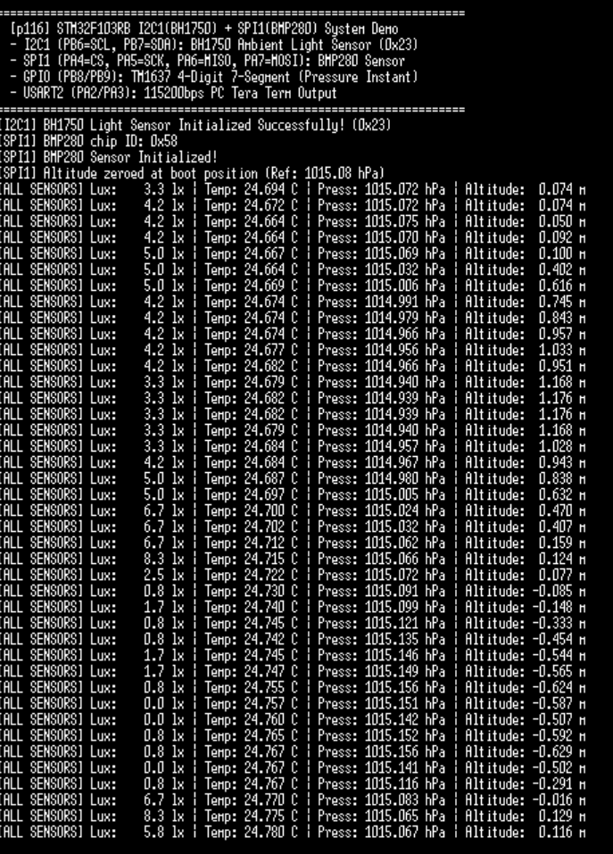
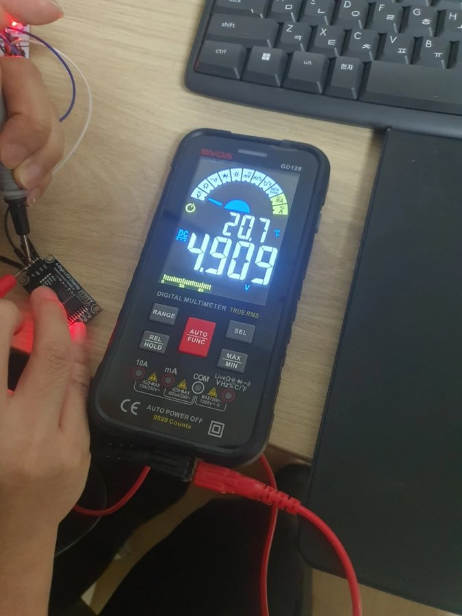
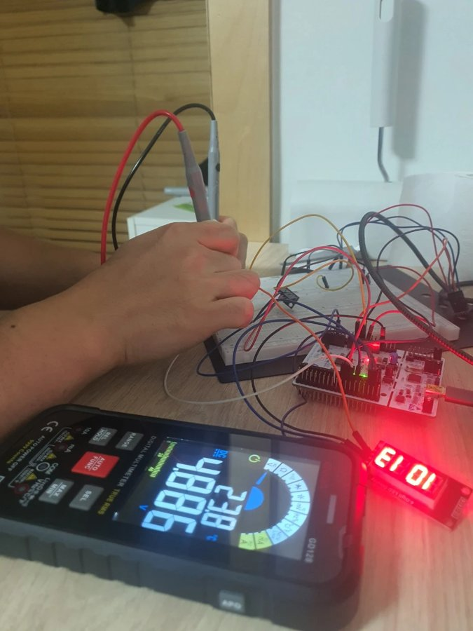
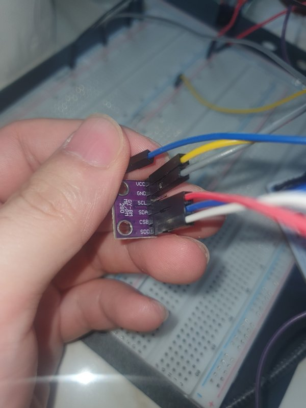
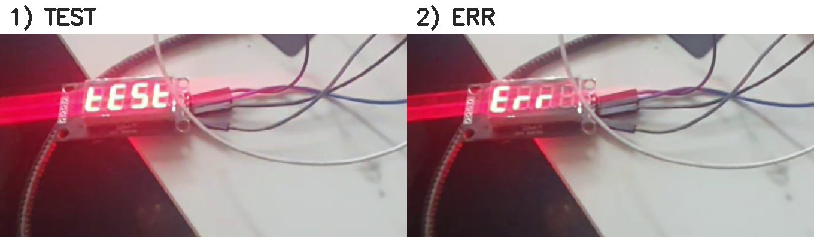
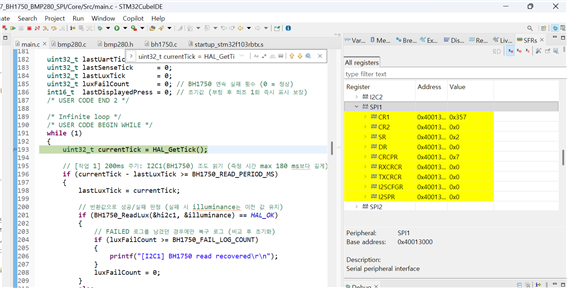
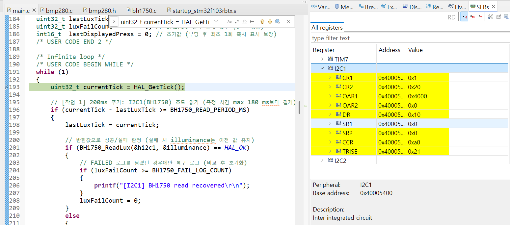
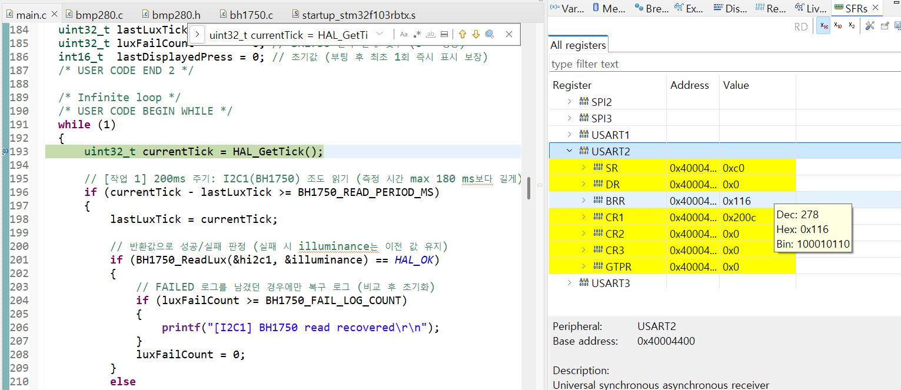

# 06. 테스트 및 최종 결과

> **요약** — 요구사항 8개를 합격 기준과 함께 실제 보드에서 모두 검증했고, 고장 주입 3건으로 오류 처리도 확인했습니다. 리소스 사용량은 Flash 30 %, RAM 13 %입니다.
>
> 모든 결과는 **[실측] 보드에서 측정·관찰 / [계산] 설정값으로 계산 / [미검증]** 중 하나로 표시했습니다. 증거(로그·사진)가 없는 항목은 성공으로 적지 않았습니다.

---

## 0. 검증 매트릭스 (한눈에 보기)

| # | 요구사항 | 검증 방법 | 합격 기준 | 결과 | 증거 |
|---|---|---|---|---|---|
| R1 | BMP280 SPI 통신 | 부팅 시 Chip ID 읽기 | `0x58` | ✅ 실측 `0x58` | [2-2](#2-2-bmp280-기압온도고도), 로그 |
| R2 | 부팅 위치 = 고도 0 m | 부팅 직후 고도 출력 | \|고도\| < 0.2 m (RMS 잡음 4 cm의 5배) | ✅ 실측 0.074 m | [2-2](#2-2-bmp280-기압온도고도) |
| R3 | 고도가 높이 변화를 따라감 | 보드를 들어 올리고 내림 | 올리면 +, 내리면 − | ✅ 실측 +1.176 m / −0.629 m | [2-2](#2-2-bmp280-기압온도고도) |
| R4 | BH1750 조도 측정 | 손으로 센서를 가림 | 가리면 감소, 치우면 증가 | ✅ 실측 0.0 ~ 140.8 lx | [2-3](#2-3-bh1750-조도) |
| R5 | TM1637 기압 표시 | 7-segment 관찰 | 정수 hPa 표시 | ✅ 실측 `1018` 표시 | [2-4](#2-4-tm1637-표시) |
| R6 | 주기 분리 (100 / 200 / 500 ms) | UART 출력 간격 | 500 ms마다 1줄 | ✅ 실측 평균 **500.42 ms** (316 간격) · 센서 주기는 [계산] | [2-5](#2-5-uart-로그) |
| R7 | 부팅 자가진단 표시 | 센서 정상 / 비정상 부팅 | `GOOD` / `ERR ` | ✅ 실측 둘 다 | [2-1](#2-1-부팅-시퀀스), [3-3](#3-3-부팅-전-bmp280-전원-분리) |
| R8 | 동작 중 I2C 장애 감지 | BH1750 SDA/SCL 분리 | `FAILED` 로그 1회 | ✅ 실측 | [3-2](#3-2-동작-중-bh1750-선-분리) |

---

## 1. 테스트 환경

| 구분 | 내용 |
|---|---|
| 보드 | NUCLEO-F103RB (MB1136 rev C), STM32F103RBT6, SYSCLK 64 MHz (HSI) |
| 센서·표시기 | GY-302 (BH1750, I2C1), GY-BMP280 (SPI1, Mode 3, 8 MHz), TM1637 4-digit 모듈 (5 V) |
| 펌웨어 | 커밋 `26086a5` (STM32CubeIDE, Debug 구성, STM32Cube FW_F1 V1.8.7) |
| 로그 | Tera Term, ST-LINK 가상 COM 포트, 115200 bps 8N1 |
| 계측기 | Agilent DSO3152A 오실로스코프 (프로브 ×10), 멀티미터 |
| 측정 장소 | 실내 책상 위 |

---

## 2. 기능 검증 (정상 동작)

### 2-1. 부팅 시퀀스

```
[I2C1] BH1750 Light Sensor Initialized Successfully! (0x23)
[SPI1] BMP280 chip ID: 0x58
[SPI1] BMP280 Sensor Initialized!
[SPI1] Altitude zeroed at boot position (Ref: 1015.08 hPa)
[ALL SENSORS] Lux:    3.3 lx | Temp: 24.694 C | Press: 1015.072 hPa | Altitude:  0.074 m
```

정상 부팅 시 7-segment (RESET 버튼 → 부팅, 영상에서 캡처):



- 초기화 순서: TM1637(`TEST` 표시) → BH1750 → BMP280(Chip ID 확인) → 고도 0점 → 자가진단 표시(`GOOD`/`ERR `) → 메인 루프
- 0점 설정 직후 첫 출력 고도 **0.074 m** → 정지 상태 잡음 범위 안에서 0 m 근처로 시작

### 2-2. BMP280 (기압·온도·고도)

부팅 후 보드를 크게 들어 올렸다가 책상 아래로 내렸습니다 (500 ms 간격 로그).



| 항목 | 결과 | 판정 |
|---|---|---|
| Chip ID | `0x58` (데이터시트 기본값과 일치) | ✅ [실측] |
| 정지 상태 고도 변동 | 0.050 ~ 0.100 m (약 5 cm) | ✅ [실측] 데이터시트 RMS 잡음 4.0 cm(Table 7)와 같은 수준 |
| 들어 올림 | 기압 1014.939 hPa까지 감소 → 고도 **+1.176 m** | ✅ [실측] |
| 내림 | 기압 1015.156 hPa까지 증가 → 고도 **−0.629 m** | ✅ [실측] |
| 제자리 복귀 | 고도 0.116 m | ✅ [실측] |
| 온도 | 24.7 °C 전후 (실내) | ⚠ [실측] 기준 온도계와 비교 안 함 |
| 기압 절대값 | 1015 hPa 전후 | ⚠ 기상청 관측값과 비교 안 함 |

> **판단:** 이 프로젝트의 고도는 **부팅 위치 기준 상대 고도**입니다. 절대 정확도(해발 고도)는 목표가 아니므로, "높이 변화의 방향과 크기를 따라가는가"를 합격 기준으로 삼았습니다.

### 2-3. BH1750 (조도)

| 조건 | 결과 | 판정 |
|---|---|---|
| 손으로 센서를 가림 → 치움 | 0.0 lx ↔ 8.3 lx (어두운 실내) | ✅ [실측] |
| 밝은 실내 | 140.8 lx | ✅ [실측] |
| 갱신 주기 | 200 ms (측정 시간 max 180 ms보다 길게, BH1750FVI 데이터시트 p.2) | [계산] 코드 기준 |
| 절대값 정확도 | 기준 조도계와 비교 안 함 | ⚠ [미검증] |

### 2-4. TM1637 (표시)

| 항목 | 결과 | 판정 |
|---|---|---|
| 기압 표시 | 측정 기압을 반올림한 정수 (`1018` 등) 표시 | ✅ [실측] [배선 사진](02_hardware.md) |
| CLK Open-Drain 변경 후 동작 | 변경 후에도 표시 정상 | ✅ [실측] |
| TM1637 전원 (NUCLEO 5V 핀) | **4.886 V** | ✅ [실측] 멀티미터 |
| 입력 High 기준 V<sub>IH</sub> | 0.7 × 4.886 V = **3.42 V** (TM1637 데이터시트 p.14) | [계산] |
| CLK(PB8) High 레벨 | **4.909 V** (표시 갱신이 없을 때 CLK는 High로 대기) → V<sub>IH</sub>보다 1.49 V 높음 | ✅ [실측] 멀티미터 |

| CLK(PB8) — 빨강: CLK, 검정: GND | NUCLEO 5V 핀 — 빨강: 5V, 검정: GND |
|---|---|
|  |  |

> **판단:** 변경 전 Push-Pull에서는 CLK High가 3.3 V여서, 실제 전원 기준 V<sub>IH</sub> 3.42 V보다도 **0.12 V 낮았습니다.** Open-Drain으로 바꾼 뒤에는 모듈 풀업이 CLK를 전원 전압 근처(4.909 V)까지 올려 기준을 만족합니다. 두 값(4.909 / 4.886 V)은 측정 시점이 달라 USB 전원 변동이 섞여 있습니다. 둘 다 약 4.9 V로, "CLK High ≈ 모듈 전원"이라는 결론은 같습니다.

### 2-5. UART 로그

| 항목 | 결과 | 판정 |
|---|---|---|
| 출력 간격 | Tera Term 타임스탬프 로그 ([원본](logs/teraterm_20261118_timestamp.log)) 19:18:59 ~ 19:21:37 구간 2분 38초, 317줄 → 316개 간격 평균 **500.42 ms**. 연속 구간 297개 간격은 **481 ~ 520 ms** (표준편차 2.1 ms) | ✅ [실측] |
| 줄바꿈 | `\r\n`만 전송 (`\r` 중복 제거 후에도 Tera Term 표시 정상) | ✅ [실측] |

- 타임스탬프는 PC 시계 기준이라 USB·OS 지연이 섞입니다. 로그 중 한 번 약 6.2초 동안 수신이 멈췄다가 12줄이 한꺼번에 들어왔지만, 그 구간을 포함한 전체 평균도 500.42 ms입니다. 따라서 **MCU는 계속 500 ms마다 출력했고 PC 쪽에서 늦게 받은 것**으로 판단했습니다.
- 로그 앞부분 31줄과 19:31:30에 추가된 26줄은 로그를 시작할 때 화면 버퍼가 한꺼번에 기록된 것이라(같은 시각으로 찍힘) 계산에서 제외했습니다.

---

## 3. 고장 주입 테스트

정상 동작뿐 아니라 **고장이 났을 때 펌웨어가 그것을 드러내는지**를 3가지 경우로 확인했습니다.

### 3-1. BMP280 SPI 오배선 — 실제 발생

| 항목 | 내용 |
|---|---|
| 상황 | SPI 선을 NUCLEO 모르포 핀 CN10-26/28/30에 연결 (F103RB에서는 PB15/PB14/PB13) |
| 기대 동작 | Chip ID 불일치 → 초기화 실패 표시 |
| 결과 | `BMP280 Sensor Initialization FAILED!` + 7-segment `ERR ` |
| 판정 | ✅ [실측] Chip ID 검사가 "통신 함수는 성공했지만 센서와 대화하지 못한" 상태를 잡아냄 |

상세 디버깅 과정: [05_troubleshooting.md 1장](05_troubleshooting.md#1-실제-사례-1-bmp280-spi-통신-실패--nucleo-모르포-핀-오배선)

### 3-2. 동작 중 BH1750 선 분리

```
[ALL SENSORS] Lux:  140.8 lx | Temp: 25.653 C | Press: 1014.817 hPa | Altitude:  0.124 m
[I2C1] BH1750 read FAILED 5 times in a row! Check PB6/PB7 wiring
[ALL SENSORS] Lux:  140.8 lx | Temp: 25.648 C | Press: 1014.817 hPa | Altitude:  0.124 m
```

| 단계 | 기대 동작 | 결과 | 판정 |
|---|---|---|---|
| SDA/SCL 분리 | 5회 연속 실패(약 1초) 후 `FAILED` **1회만** 출력 | 1회 출력, 반복 출력 없음 | ✅ [실측] |
| 분리 중 다른 기능 | BMP280·UART는 계속 동작 | 기압·고도 계속 갱신 | ✅ [실측] |

### 3-3. 부팅 전 BMP280 전원 분리

| 항목 | 내용 |
|---|---|
| 상황 | BMP280 모듈의 VCC 선을 뺀 상태로 RESET |
| 기대 동작 | Chip ID를 읽지 못함 → 초기화 실패 → `ERR ` 표시 |
| 결과 | `TEST` → `ERR ` |
| 판정 | ✅ [실측] |

| VCC 선 분리 | 부팅 결과 |
|---|---|
|  |  |

---

## 4. 타이밍 (계산값과 레지스터 확인)

파형 측정은 오실로스코프 고장으로 하지 못했습니다. 대신 디버거로 **주변장치 레지스터(SFR) 값**을 읽어, 코드 설정이 하드웨어에 의도대로 들어갔는지 확인했습니다.

| 항목 | 계산값 | 산출 근거 | 확인 |
|---|---|---|---|
| SPI SCK | 8 MHz, Mode 3 (1 바이트 = 1 µs) | PCLK2 64 MHz ÷ 8 | ✅ `SPI1->CR1` = **0x0357** (BR = 010 → ÷8, CPOL = 1, CPHA = 1, MSTR = 1, SPE = 1, SSM·SSI = 1) [디버거] — RM0008 25.5.1, p.742 |
| I2C SCL | 100 kHz | PCLK1 32 MHz ÷ (2 × CCR 160) ([03 문서](03_cubemx_configuration.md) 4절) | ✅ `I2C1->CR2` FREQ = **0x20** (32 MHz), `CCR` = **0xA0** (160, F/S = 0 → Standard mode), `TRISE` = **0x21** (33), `CR1` = 0x1 (PE = 1) [디버거] — RM0008 26.6.8 p.781, 26.6.9 p.782 |
| UART 보레이트 | 115,108 bps (오차 약 −0.08 %) | 32 MHz ÷ (16 × 17.375), BRR = 0x116 | ✅ `USART2->BRR` = **0x116** (DIV_Mantissa 17, DIV_Fraction 6), `CR1` = 0x200C (UE, TE, RE = 1) [디버거] — RM0008 27.6.3 p.820 · 로그 정상 수신 |
| UART 1줄 전송 시간 | 약 7.9 ms (blocking) | 약 91 B × 10 bit ÷ 115,108 bps | [계산] |

| SPI1 | I2C1 | USART2 |
|---|---|---|
|  |  |  |

> 레지스터 값은 `main.c`의 `while (1)` 첫 줄에 중단점을 걸어, 모든 초기화와 첫 통신이 끝난 뒤 읽었습니다. 세 주변장치 모두 **RM0008 레지스터 정의와 클럭 설정으로 계산한 기대값과 일치**했습니다.
| BMP280 측정 시간 | typ 37.5 / max 43.2 ms | 데이터시트 Table 13 (×16 / ×2) | — |
| BH1750 측정 시간 | typ 120 / max 180 ms | BH1750FVI 데이터시트 p.2 | — |
| 부팅 0점 대기 | 50 ms | max 43.2 ms + 여유 | — |

---

## 5. 리소스 사용량

커밋 `26086a5` 빌드 산출물(`Debug/*.elf`)의 섹션 크기 기준입니다.

| 영역 | 구성 | 크기 | 사용률 |
|---|---|---|---|
| **Flash** | `.isr_vector` 268 + `.text` 36,584 + `.rodata` 2,124 + `.ARM`/init/fini 16 + `.data` 초기값 476 | **39,468 B (38.5 KiB)** | **30.1 %** / 128 KiB |
| **RAM (정적)** | `.data` 476 + `.bss` 660 | 1,136 B | 5.5 % / 20 KiB |
| **RAM (예약 포함)** | 정적 1,136 + Heap 0x200 + Stack 0x400 | **2,672 B (2.6 KiB)** | **13.0 %** / 20 KiB |

---

## 6. 한계

1. 모든 통신이 **blocking 폴링**입니다. UART 1줄(약 8 ms) 전송 동안 CPU가 기다립니다. 인터럽트/DMA는 쓰지 않았습니다.
2. 클럭이 HSE가 아닌 **HSI** 기반이라, 온도에 따른 클럭 오차가 UART 보레이트 여유를 줄입니다.
3. 센서 절대값(온도·기압·조도)은 기준 장비와 비교하지 않았습니다. 이 프로젝트는 **상대 변화와 통신·표시 동작 검증**이 목표입니다.

## 7. 개선 계획

| 우선순위 | 개선 | 기대 효과 |
|---|---|---|
| 중 | UART TX를 `HAL_UART_Transmit_IT/DMA` 또는 링버퍼로 전환 | CPU blocking 제거 |
| 낮음 | 미사용 TM1637 API 활용(온도 소수점 표시 등) 또는 제거 | 코드 정리 |

## 8. 재현 방법

1. STM32CubeIDE에서 프로젝트를 열고 Debug 구성으로 빌드 → NUCLEO-F103RB에 다운로드
2. Tera Term: ST-LINK 가상 COM 포트, **115200 bps, 8N1**
3. 배선: [02_hardware.md](02_hardware.md) (SPI는 CN10-11/13/15 = D13/D12/D11 사용, CN10-26/28/30 아님)
4. 부팅 로그에서 `chip ID: 0x58`, `Altitude zeroed` 확인 → 7-segment `GOOD` 후 기압 표시
